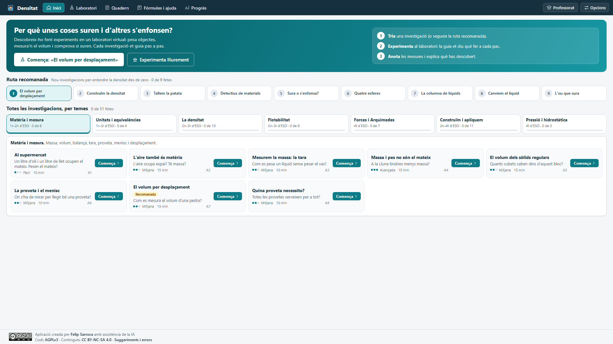
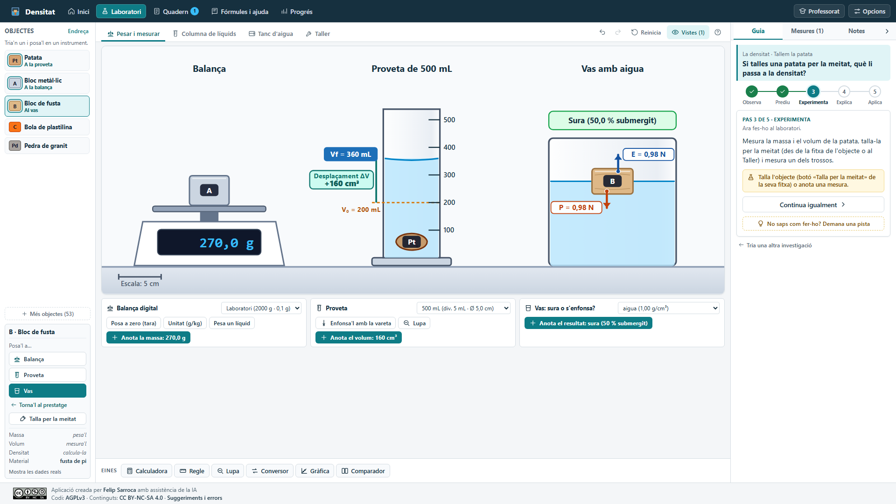
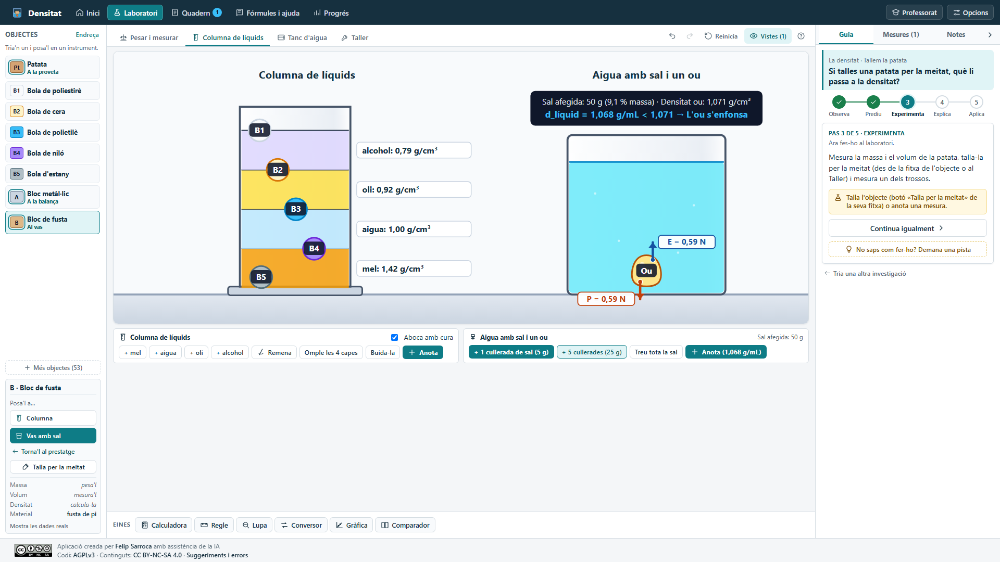
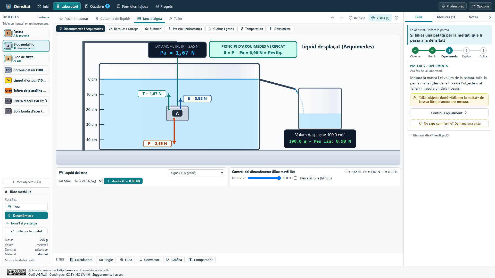
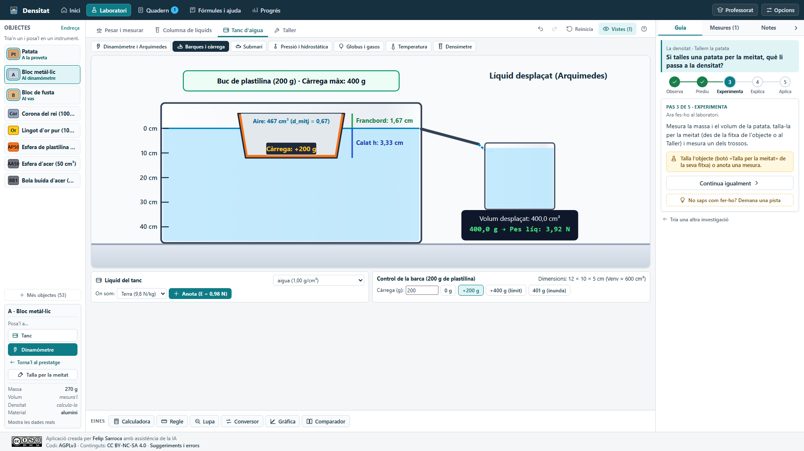
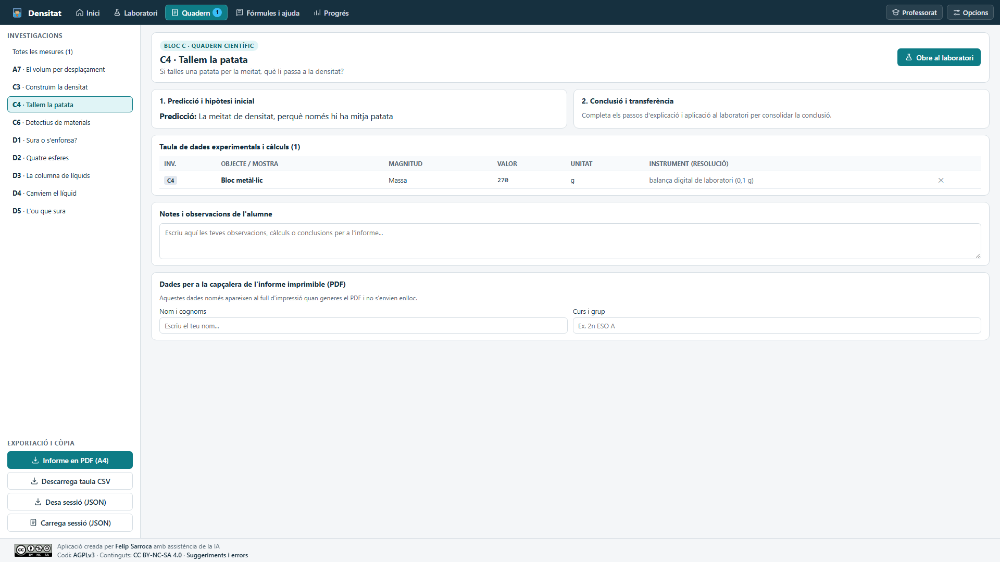
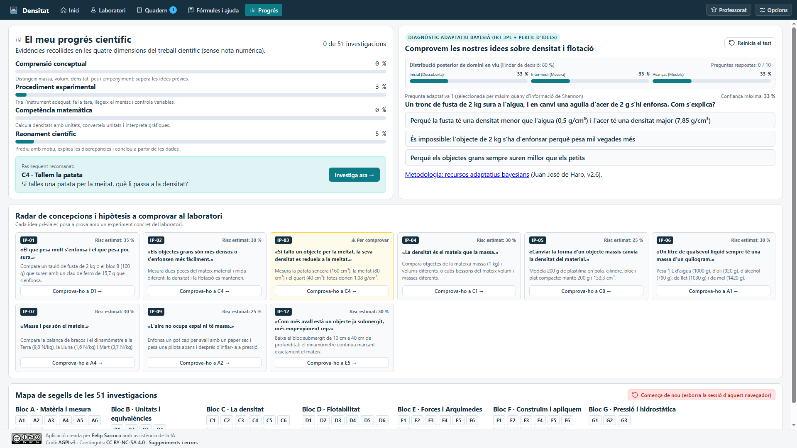

# Densitat · Laboratori virtual de densitat i flotació

[](https://ja.cat/labdensitat)
[](#arquitectura-tècnica)
[](LICENSE)
[](https://creativecommons.org/licenses/by-nc-sa/4.0/deed.ca)

**Densitat** és un laboratori virtual interactiu de matèria, mesura, densitat, flotabilitat, principi d'Arquimedes i pressió hidrostàtica adreçat a l'alumnat i al professorat de **1r a 4t d'ESO**.

En lloc d'una col·lecció d'animacions predeterminades, tota l'aplicació funciona sobre **un únic motor físic coherent i verificat**: un bloc d'alumini de 100 cm³ marca 270 g a la balança, fa pujar 100 mL el nivell de la proveta, s'enfonsa a l'aigua, té un pes aparent d'1,67 N al dinamòmetre quan està submergit (empenyiment de 0,98 N) i, si es talla, cada tros conserva exactament 2,70 g/cm³.

**[Obre l'aplicació a GitHub Pages](https://felipsarroca.github.io/edu-apps/Densitat/)** · **[Enllaç curt: ja.cat/labdensitat](https://ja.cat/labdensitat)**

---

## Captures de pantalla

### Pantalla d'inici: una acció principal, la ruta recomanada i les investigacions per temes


### Zona «Pesar i mesurar»: balança digital, proveta i vas de flotació, amb la guia pas a pas


### Zona «Columna de líquids»: torre de líquids i dissolució de sal amb l'ou


### Zona «Tanc d'aigua»: dinamòmetre, vas de vessament d'Arquimedes i assaig de barques



### Quadern científic integrat i diagnòstic adaptatiu bayesià



---

## Pensada perquè no calgui ser expert

- **Inici amb un sol camí clar:** un botó principal per començar o continuar, una **ruta recomanada** de nou investigacions en ordre i la resta agrupades per temes, amb la dificultat i la durada de cadascuna.
- **Guia pas a pas:** a cada pas del laboratori, la guia diu què cal fer, indica què falta («en portes 1 de 2 mesures») i, en acabar, proposa la investigació següent.
- **Primers passos visibles:** la primera vegada que s'entra al laboratori es mostra una targeta de tres passos (tria un objecte, posa'l en un instrument, anota la mesura), recuperable amb el botó d'ajuda.
- **Vista senzilla per defecte:** rètols en llenguatge planer i només els objectes de l'activitat. Al menú **Opcions**, la **vista completa** afegeix els detalls tècnics (resolucions, codis d'investigació), el catàleg sencer i les ampolles de líquids; també s'hi activen la lectura fàcil, el mode projector i el nivell.

## Què inclou l'aplicació

### 1. Quatre zones de treball i un prestatge d'objectes persistents
- **Mesura:** balança digital (models de cuina d'1 g, de laboratori de 0,1 g i de precisió de 0,01 g, amb tara i canvi d'unitat g/kg), cinc provetes graduades (25, 100, 250, 500 i 1000 mL) amb comprovació del diàmetre de boca, vareta d'immersió, **lupa interactiva de menisc** (error de paral·laxi amb l'ull alt/baix i lectura de la tangent) i vas d'assaig amb sis líquids.
- **Columna:** columna multicapa de líquids (mel, aigua, oli, alcohol) amb control d'abocat amb cura, vareta de remenar (mescla de líquids miscibles de la mateixa família i separació d'inmiscibles) i estació de dissolució de sal en cullerades de 5 g fins al límit de saturació (26 %).
- **Tanc:** tanc hidrostàtic amb regle en centímetres, dinamòmetre amb control continu d'immersió, vas de vessament d'Arquimedes amb vas col·lector sobre balança, selector planetari de gravetat (Terra, Lluna i Mart) i mòduls d'assaig per a **barques i càrrega**, **submarí amb tanc de llast**, **sonda de pressió hidrostàtica**, **cambra de globus i gasos**, **bany tèrmic (0–100 °C)** i **densímetre**.
- **Taller i Drassana:** ganivet per dividir objectes en fraccions (conservant la densitat), banc de modelat en formes compactes, constructor d'objectes («L'objecte impossible», on només es poden fixar dues de les tres magnituds `material`, `massa` i `volum`) i drassana paramètrica de bucs (`L × B × H`).

### 2. Cinquanta-una investigacions guiades en set blocs
| Bloc | Tema | Investigacions | Cursos orientatius |
|---|---|---|---|
| **A** | Matèria i mesura | A1 a A8 (8) | 1r–2n d'ESO |
| **B** | Unitats i equivalències | B1 a B4 (4) | 1r–3r d'ESO |
| **C** | La densitat | C1 a C10 (10) | 2n–3r d'ESO |
| **D** | Flotabilitat | D1 a D8 (8) | 2n–3r d'ESO |
| **E** | Forces i Arquimedes | E1 a E7 (7) | 4t d'ESO |
| **F** | Construïm i apliquem | F1 a F11 (11) | 2n–4t d'ESO |
| **G** | Pressió i hidrostàtica | G1 a G3 (3) | 4t d'ESO |

Cada investigació segueix el cicle d'indagació **Observa → Prediu (amb motiu) → Experimenta i mesura → Explica → Aplica**, amb pistes graduades en tres graons, versió de **lectura fàcil (nivell A2)** i detecció socràtica de 20 idees prèvies (`IP-01` a `IP-20`), 7 errors de procediment (`EP-01` a `EP-07`) i 8 errors matemàtics i d'unitats (`EM-01` a `EM-08`).

### 3. Eines de pensament i mirades sincronitzades
- **Calculadora amb fitxes d'unitats:** opera amb les mesures anotades al quadern i diagnostica l'error d'invertir el quocient (`V / m` en lloc de `m / V`).
- **Conversor i escala d'unitats:** escales visuals de massa (graons de 10), capacitat (graons de 10), volum (graons de 1000) i factors de conversió de densitat.
- **Gràfica massa-volum:** representa els punts experimentals del quadern, les rectes de pendent igual a la densitat i la recta frontera de l'aigua.
- **Comparador A / B:** permet contrastar dues situacions i avisa si s'ha modificat més d'una variable independent alhora.
- **Mirades sincronitzades:** vista de **Cubets d'1 cm³**, vista de **Volums i cavitats**, diagrama de **Vectors de força** (`P`, `E`, `N`, `T`) i **Model didàctic de partícules** amb avís explícit dels seus límits.

### 4. Quadern científic, diagnòstic adaptatiu bayesià i mode docent
- **Quadern científic:** recull prediccions, taules de mesures, càlculs i conclusions; exportable com a **informe en PDF (A4)**, **CSV** per a Google Sheets i **JSON** de còpia de seguretat (tot local al navegador, sense registre ni servidor).
- **Diagnòstic adaptatiu bayesià:** combina l'estimació ordinal de domini (IRT 3PL amb discriminació efectiva `a_ef = 1,25` i sostre de domini `0,95`) amb el perfil d'idees prèvies (priors informatius no uniformes `0,25–0,35` i selecció per màxim guany d'informació de Shannon), seguint l'[especificació operativa de Juan José de Haro (v2.6)](https://jjdeharo.github.io/recursos-adaptativos/).
- **Mode docent:** mode projector per a pissarra digital, mode d'anàlisi, generador d'enllaços per a Google Classroom (amb fixació de nivell per URL), solucionari complet de les 51 investigacions, rúbrica de la situació d'aprenentatge i utilitat de validació Monte Carlo.

---

## Arquitectura tècnica i proves

L'aplicació està construïda amb **HTML5, CSS3, SVG i mòduls ES de JavaScript natiu**, sense compilació ni dependències externes:

- `js/fisica/`: motor físic pur (sense accés al DOM ni a l'emmagatzematge).
- `js/dades/`: catàlegs de 32 materials, 11 líquids, 7 gasos, 77 objectes, 12 recipients, 12 instruments, glossari trilingüe (català, castellà, anglès) i les 51 investigacions.
- `js/estat/`: magatzem d'estat únic amb historial de Desfés / Refés, persistència local i codificació d'escenes a l'URL.
- `js/guia/`: motor pedagògic i diagnòstic adaptatiu bayesià.
- `js/laboratori/`, `js/eines/`, `js/quadern/`, `js/pantalles/`: interfície vectorial escalable (`--ui-zoom`) verificada a 1920 × 1080, 1366 × 768 (100 % i 125 %) i mòbil (390 × 844).

Per executar la validació de dades i les proves automàtiques del motor físic (regles `R1–R20` i casos `T01–T38`), del catàleg d'investigacions i del motor bayesià:

```bash
node scripts/valida-dades.mjs
node --test tests/fisica.test.mjs tests/investigacions.test.mjs tests/bayesia.test.mjs
```

---

## Autoria i llicència

Aplicació creada per **[Felip Sarroca](https://ja.cat/felipsarroca)** amb assistència de la IA per a l'Escola Ramon Pont (Terrassa).

- **Codi:** [GNU AGPLv3 o posterior](LICENSE).
- **Continguts:** [Creative Commons BY-NC-SA 4.0](https://creativecommons.org/licenses/by-nc-sa/4.0/deed.ca).
- **Suggeriments i errors:** [Formulari d'incidències de GitHub](https://github.com/felipsarroca/edu-apps/issues/new?template=densitat.yml).
