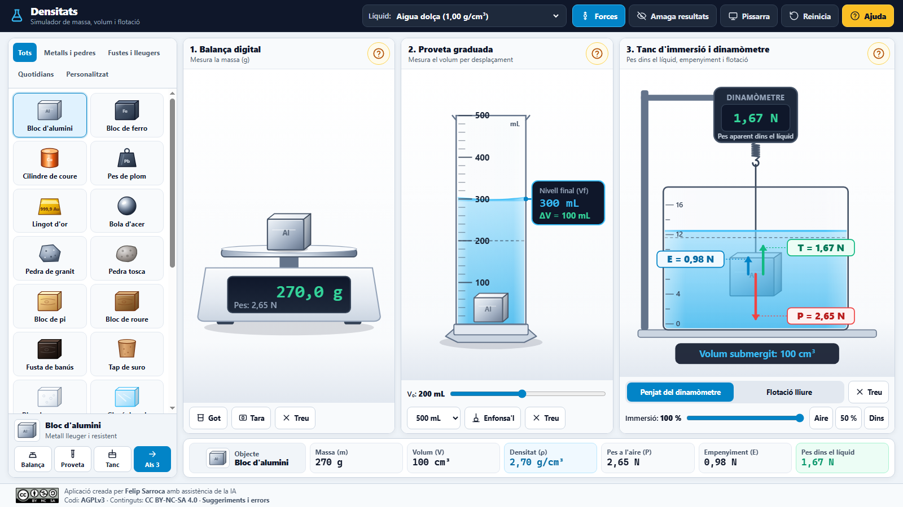
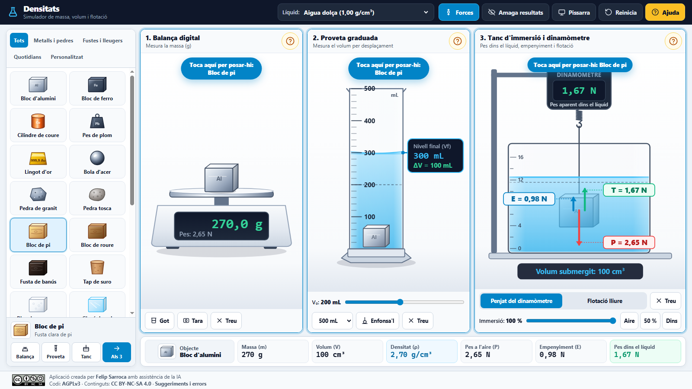
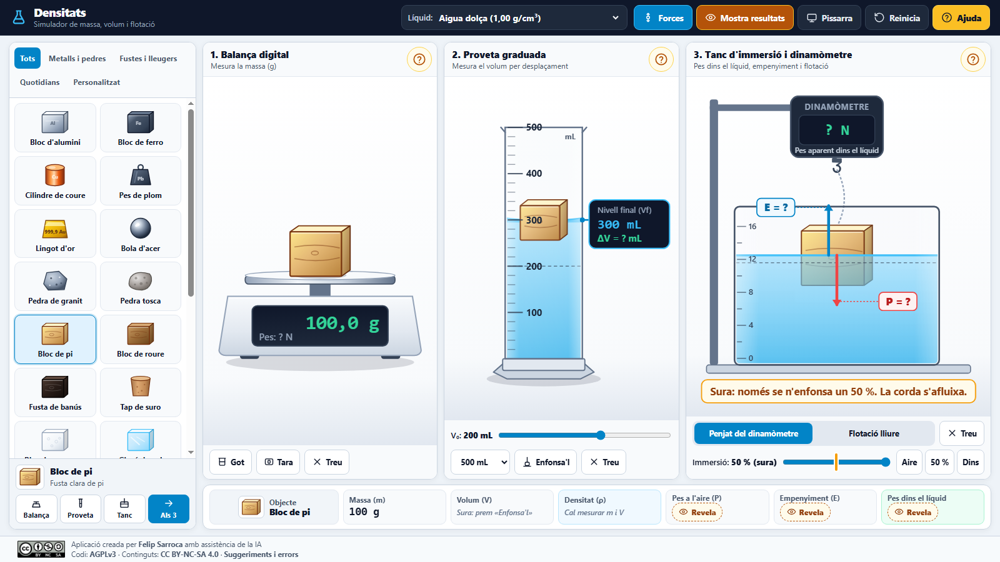
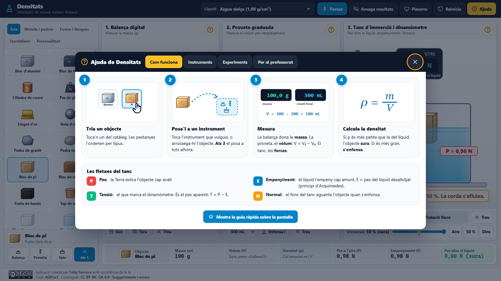
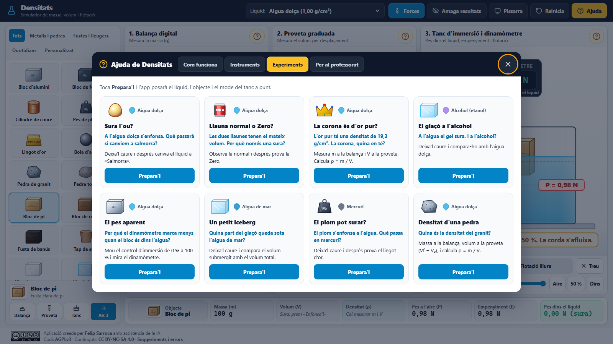

# Densitats · Simulador visual de massa, volum i flotació

**Obre l'app:** [ja.cat/densitats](https://ja.cat/densitats)

Simulador interactiu de **massa, volum, densitat, flotabilitat, principi d'Arquimedes i pes aparent dins d'un líquid**. Està pensat perquè l'alumnat faci proves pel seu compte i perquè el professorat faci demostracions a la pissarra digital tàctil.

## Com s'utilitza

1. **Tria un objecte** del catàleg.
2. **Posa'l a un instrument:** toca l'instrument o arrossega-hi l'objecte, amb el ratolí o amb el dit. El botó **Als 3** el posa a tots alhora.
3. **Mesura:** la balança dona la massa, la proveta el volum (V = Vf − V₀) i el tanc les forces.
4. **Calcula la densitat:** ρ = m / V. Si és més petita que la del líquid, l'objecte sura.

## Què inclou

- **Tres instruments sincronitzats en una sola pantalla:**
  1. **Balança digital:** mesura la massa (g) i el pes (N). Inclou un **got de 120 g** i la funció **Tara**, que funcionen com en una balança real.
  2. **Proveta graduada:** mesura el volum per desplaçament (250, 500 o 1000 mL). El botó **Enfonsa'l** submergeix del tot amb una vareta els objectes que suren. El nivell inicial es limita perquè la proveta no vessi.
  3. **Tanc d'immersió i dinamòmetre:** amb l'objecte penjat del dinamòmetre, el pes aparent baixa a mesura que l'objecte entra al líquid. Si l'objecte sura, una marca groga indica fins on s'enfonsa sol i un avís explica que la corda s'afluixa. En **flotació lliure**, l'objecte cau i s'atura amb una animació física.
- **24 objectes** (metalls i pedres, fustes i materials lleugers, i objectes quotidians com l'ou, les llaunes normal i Zero, la corona d'Arquimedes o el glaçó) i un **objecte personalitzat** amb massa i volum ajustables.
- **8 líquids:** aigua dolça, aigua de mar, salmorra, oli, alcohol, glicerina, mercuri i un líquid personalitzat.
- **Barra de resultats lligada a les mesures:** mostra l'objecte analitzat. La massa no hi apareix fins que l'objecte és a la balança, ni el volum fins que és a la proveta.

## Eines per a la classe

- **Amaga resultats:** amaga el volum, la densitat, el pes i les forces a la barra de resultats, al dinamòmetre, a la proveta i a les fletxes. Amb **Revela** es descobreixen un per un.
- **Pissarra:** posa l'app a pantalla completa, ho fa tot més gran i augmenta el contrast.
- **Forces:** mostra o amaga les fletxes P, E, T i N.
- **Pantalla tàctil:** botons grans, col·locació tocant l'instrument i arrossegament amb el dit.

## Ajuda integrada

El botó groc **Ajuda** (o la tecla `?`) obre una finestra amb quatre apartats:

- **Com funciona:** quatre passos il·lustrats i el significat de cada fletxa.
- **Instruments:** dibuix i explicació de cada instrument. També s'obre amb el botó **?** de cada instrument.
- **Experiments:** vuit experiments que es preparen amb un sol toc (l'ou en salmorra, les llaunes, la corona d'Arquimedes, el glaçó en alcohol, el pes aparent, l'iceberg, el plom en mercuri i la densitat d'una pedra).
- **Per al professorat:** com aprofitar cada eina a l'aula.

La primera vegada que s'obre l'app, una **guia ràpida** assenyala sobre la pantalla on és cada cosa. Es pot tornar a veure des de l'ajuda.

## Adaptació a la pantalla

La interfície s'escala sencera per cabre en la finestra, també en portàtils de 1366 × 768 amb l'escalat del sistema al 125 % o al 150 %, i es recalcula en redimensionar-la. En mòbils, tauletes en vertical i pissarres verticals, els instruments s'apilen i es pot desplaçar la pàgina verticalment.

## Autoria i llicència

Aplicació creada per **[Felip Sarroca](https://ja.cat/felipsarroca)** amb assistència de la IA.
- Codi font: [AGPLv3](LICENSE)
- Continguts i gràfics: [CC BY-NC-SA 4.0](https://creativecommons.org/licenses/by-nc-sa/4.0/deed.ca)
