<div align="center">

# 🧪 Laboratori d'equacions

Aplicació web interactiva en català per treballar equacions, inequacions i sistemes a 4t d'ESO


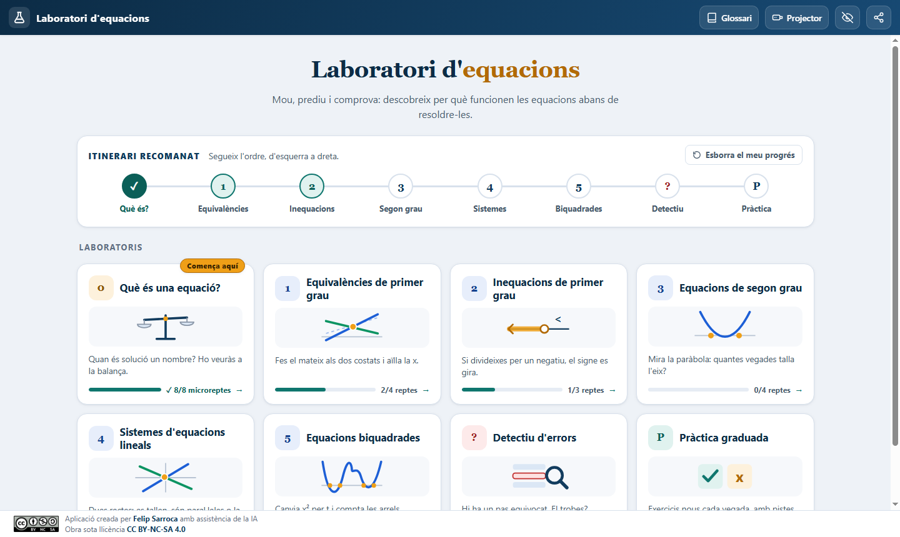

</div>

---

## Índex

1. [Què és](#què-és)
2. [La idea pedagògica](#la-idea-pedagògica)
3. [Els vuit laboratoris](#els-vuit-laboratoris)
4. [Eines per a tota l'aplicació](#eines-per-a-tota-laplicació)
5. [Com fer-la servir a l'aula](#com-fer-la-servir-a-laula)
6. [Publicar-la a GitHub Pages](#publicar-la-a-github-pages)
7. [Estructura del codi](#estructura-del-codi)
8. [Privacitat](#privacitat)
9. [Referències curriculars](#referències-curriculars)
10. [Autoria i llicència](#autoria-i-llicència)

---

## Què és

El **Laboratori d'equacions** és un conjunt de vuit laboratoris interactius en què l'alumnat **manipula** equacions i **veu** què passa: balances que s'inclinen, rectes que es tallen, paràboles que toquen l'eix X i franges de solucions a la recta numèrica.

- 🖥️ Funciona en ordinador, tauleta, mòbil i pissarra digital.
- 📴 Un cop carregada, funciona sense connexió. També s'obre fent doble clic a `index.html`.
- 🧮 El càlcul és **exacte**: fraccions i radicals, sense decimals aproximats. Cap conclusió depèn dels píxels del gràfic.
- 🇨🇦 Tot en català, amb un glossari de termes i explicacions en veu alta.

## La idea pedagògica

Cada laboratori segueix el mateix cicle:

| Pas | Què fa l'alumne | Com ho fa l'app |
|---|---|---|
| **1. Experimenta** | Mou lliscadors, aplica operacions i tria exemples | Gràfics, balança i recta numèrica es veuen des del primer moment i s'actualitzen a l'instant |
| **2. Observa** | Mira què passa amb la solució | Retroacció immediata i raonada, també quan la resposta és incorrecta |
| **3. Produeix** | Escriu ell mateix la resposta | Reparar errors al Detectiu, inventar una equació amb una solució donada, resoldre un cas tot sol |
| **4. Justifica** | Explica per què | Completar justificacions, demostracions de l'M0 i pas a pas algebraic |
| **5. Comprova** | Substitueix i verifica | Comprovador de valors i corrector que compara conjunts de solucions |

## Com s'hi treballa

Tots els laboratoris tenen la mateixa interfície, pensada perquè l'alumnat de 4t d'ESO s'hi orienti sense haver de llegir gaire:

- 🧭 **Guia de tres passos**. A sota del gràfic hi ha una barra amb tres passos, per exemple *① Mira la paràbola → ② Mira Δ → ③ Comprova*. Mostra **un sol missatge curt** cada vegada i marca amb ✓ els passos que ja s'han fet.
- 📚 **Banc d'exemples per tipus**. Cada laboratori agrupa els exemples pel que treballen (per exemple, *Dues arrels*, *Una o cap*, *Incompletes*, *Amb radicals*), i el botó **🎲 Un altre** tria un cas d'aquell grup. Els exemples són a `js/banc.js`, fàcils d'ampliar. A l'M1, **✎ La meva** permet escriure una equació pròpia. A l'M4, **✎ Edita** mostra els coeficients.
- 🧩 **Pràctica a mida**. A la pràctica, l'alumne tria *què treballa* i *quin suport vol*: amb un exemple resolt, amb els primers passos fets o tot sol.

- ✨ **Retroacció visual**. A l'M1, quan toques un terme, aquest desapareix dels dos costats. A l'M2, el signe fa una volta quan s'inverteix. I quan s'aconsegueix un repte, cau confeti.
- 🎯 **Reptes a un clic**. La pestanya *Reptes* indica quants n'has fet (per exemple, 1/3), i el botó **Prova-la ▸** carrega directament l'exemple del repte.

## Els vuit laboratoris

Les **targetes** són el centre de la pantalla d'inici: cada una té una il·lustració i una barra amb el progrés de l'alumne. A sobre, un **itinerari** discret suggereix l'ordre didàctic: es pot començar pel 0 o anar directament al que s'està treballant.

### 0 · Què és una equació?

Fes lliscar el valor de *x* i observa si els dos membres valen el mateix. Hi ha tres vistes: **balança** (amb animació: baixa el plat que pesa més), **recta numèrica** i **gràfic**. Inclou 8 microreptes per distingir una equació d'una expressió i trobar identitats i contradiccions.

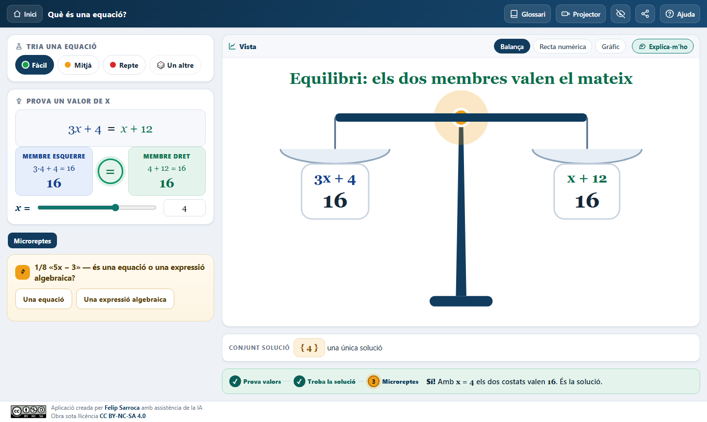

### 1 · Equivalències de primer grau

**Toca un terme** i desapareixerà dels dos costats. També pots sumar, restar, multiplicar o dividir els dos membres. Les **rectes fantasma** mostren l'estat anterior. La solució queda amagada fins que l'alumne aconsegueix aïllar la *x*. Inclou historial reversible, comprovador i el cas avançat x² = x.

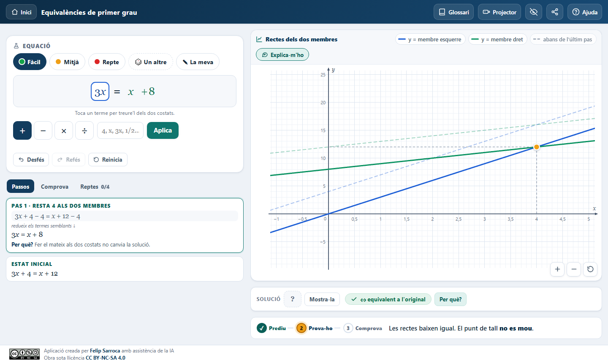

### 2 · Inequacions de primer grau

La **norma d'or del signe**: què passa en multiplicar o dividir per un negatiu? La primera vegada que multiplica o divideix per un positiu i la primera per un negatiu, l'alumne prediu si el signe s'inverteix. Després només apareix un avís breu (per exemple, «Dividim per −2: invertim el signe»). La **recta numèrica i el gràfic** surten alhora i alineats, amb extrems oberts i tancats i fletxes quan la solució continua fora de la vista.

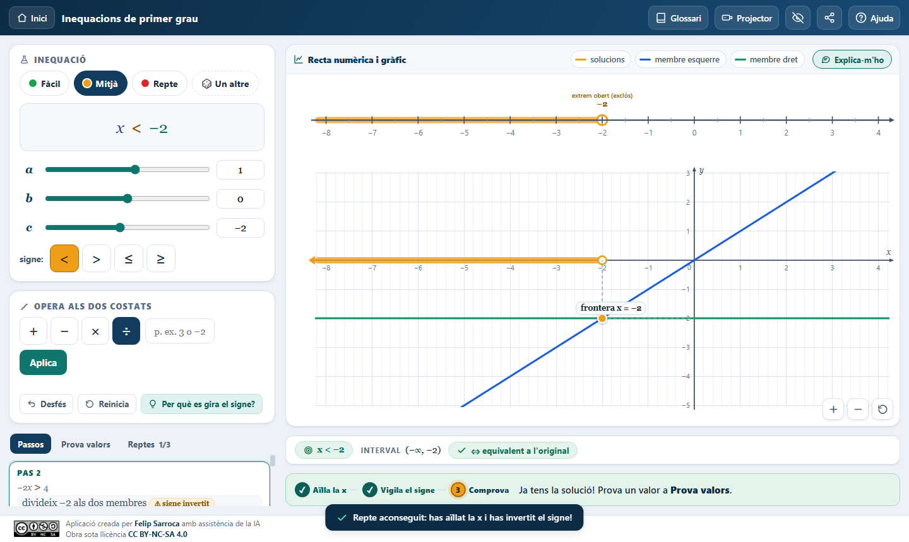

### 3 · Equacions de segon grau

Mou *a*, *b* i *c*, mira la paràbola i **prediu quantes arrels tindrà** abans de veure el discriminant. Després, la fórmula general pas a pas, la factorització i les equacions incompletes.

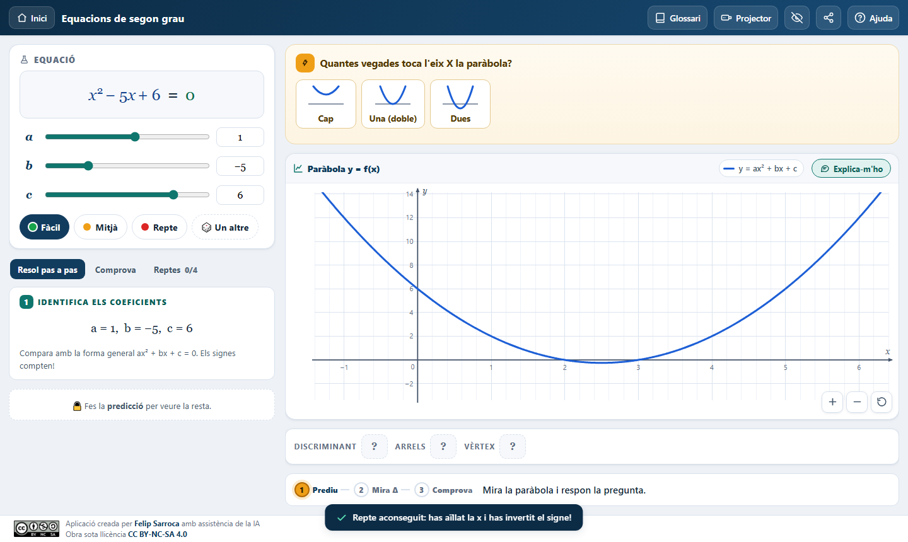

### 4 · Sistemes d'equacions lineals

Mou els sis coeficients i **classifica el sistema** (compatible determinat, compatible indeterminat o incompatible). La classificació sempre es fa per àlgebra, mai a ull. Els mètodes de reducció, substitució i igualació es mostren pas a pas, amb les igualtats una sota l'altra. Amb el botó **Escala 1:1**, els pendents es veuen amb la inclinació real. Si cliques el gràfic, comproves si un punt és solució.

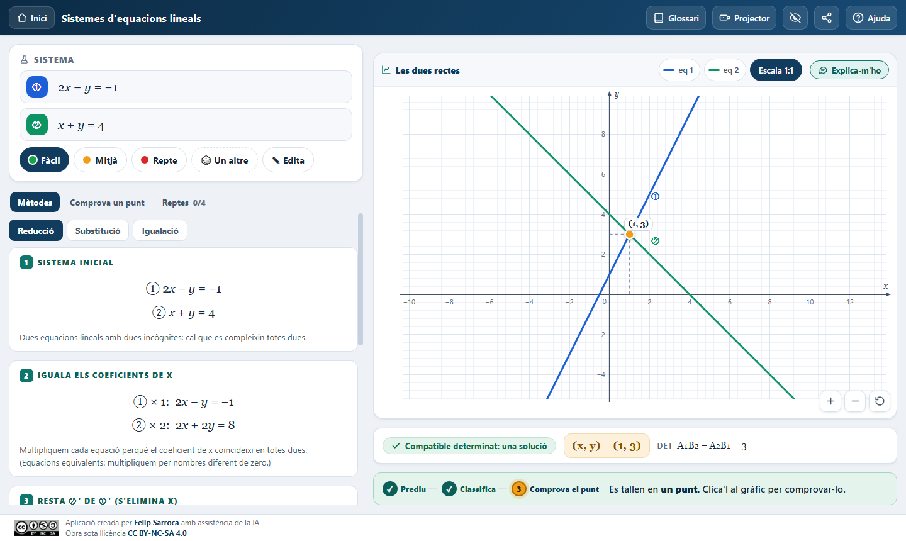

### 5 · Equacions biquadrades

El canvi de variable *t = x²* en **tres nivells sincronitzats**: l'equació original, l'equació auxiliar en *t* i les arrels en *x*. Desmunta el mite que diu que una biquadrada sempre té «0, 2 o 4» arrels.

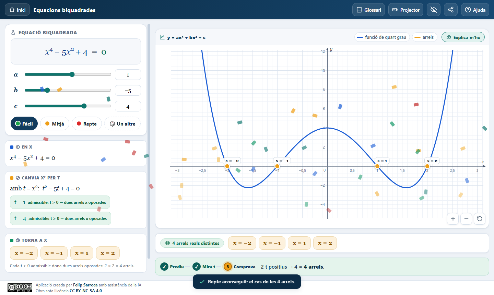

### 🔍 Detectiu d'errors

Hi ha 12 resolucions amb un **pas enverinat**. L'alumne ha de trobar el pas incorrecte, justificar per què falla i aprendre a reparar-lo. El títol no revela el tipus d'error fins que es resol el cas. Després, pot provar un cas anàleg nou.

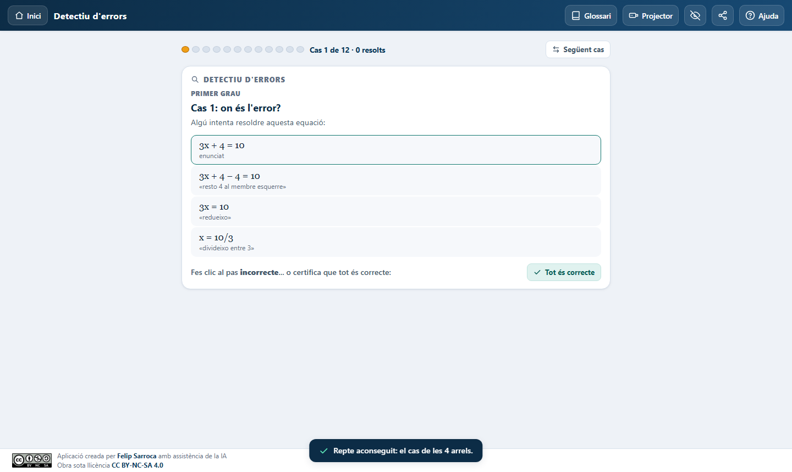

### ✏️ Pràctica graduada

Exercicis generats a l'instant en quatre nivells (*comprendre*, *amb ajuda*, *autònom* i *aprofundeix*), amb **pistes graduades**, pas a pas i solucions raonades. El corrector accepta fraccions equivalents, qualsevol ordre de les solucions i valors exactes amb radicals.

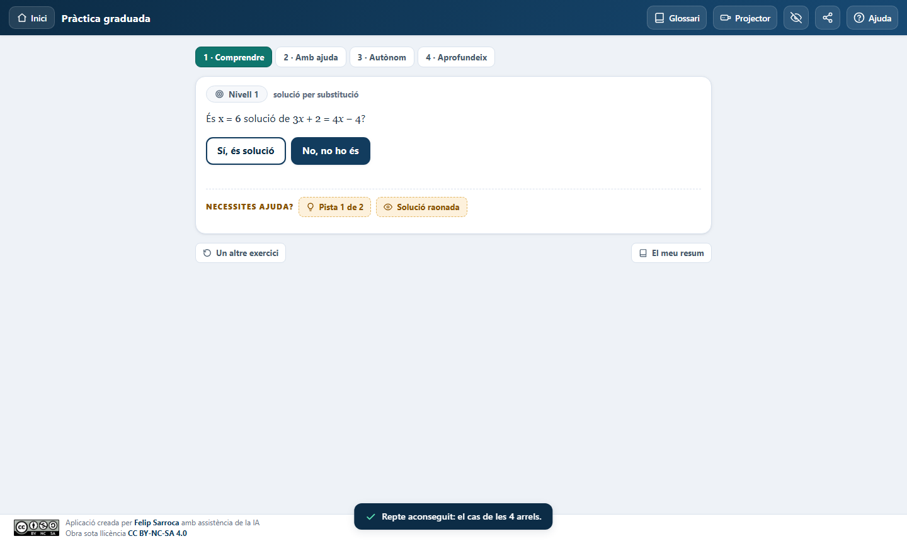

## Eines per a tota l'aplicació

| Eina | Per a què serveix |
|---|---|
| 🗣️ **Explica-m'ho** | Explica en llenguatge planer què mostra el gràfic, i ho pot **llegir en veu alta** en català. Va molt bé per a l'alumnat nouvingut o amb NESE. |
| 📖 **Glossari** | 25 termes clau en ordre alfabètic, amb exemples |
| 📽️ **Mode projector** | Lletra i controls grans per a la pissarra digital |
| 🙈 **Amagar respostes** | Tapa les solucions per debatre amb el grup abans de revelar-les |
| 🔗 **Comparteix** (icona d'enllaç) | Copia un enllaç que obre l'activitat exactament amb la mateixa configuració. Es pot penjar a Google Classroom. |
| 📈 **Progrés** | Barres a cada targeta i a l'itinerari. Es pot esborrar amb un clic. |
| ❓ **Ajuda** | Una guia breu de cada laboratori |

<p align="center">
  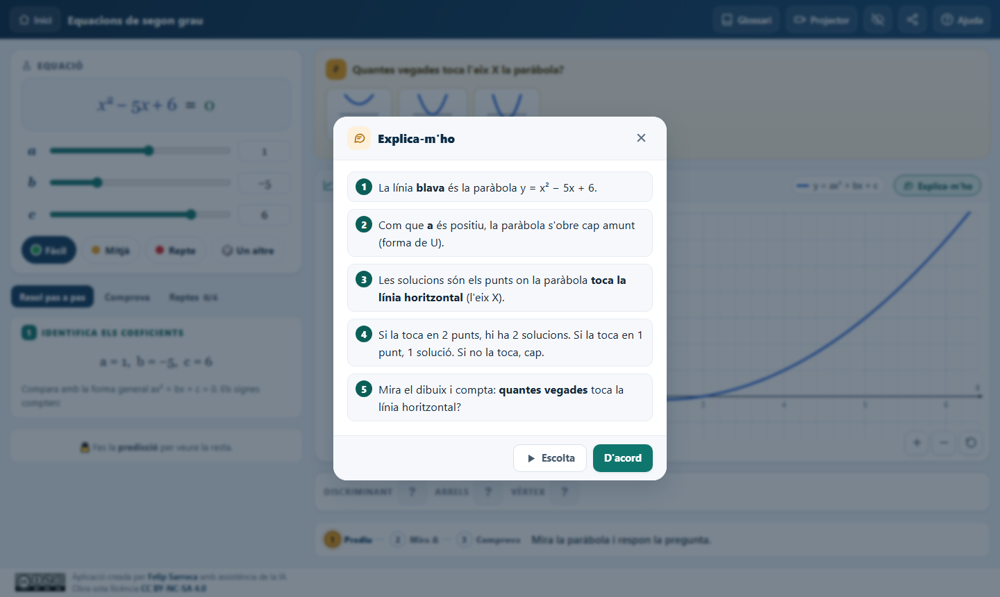
  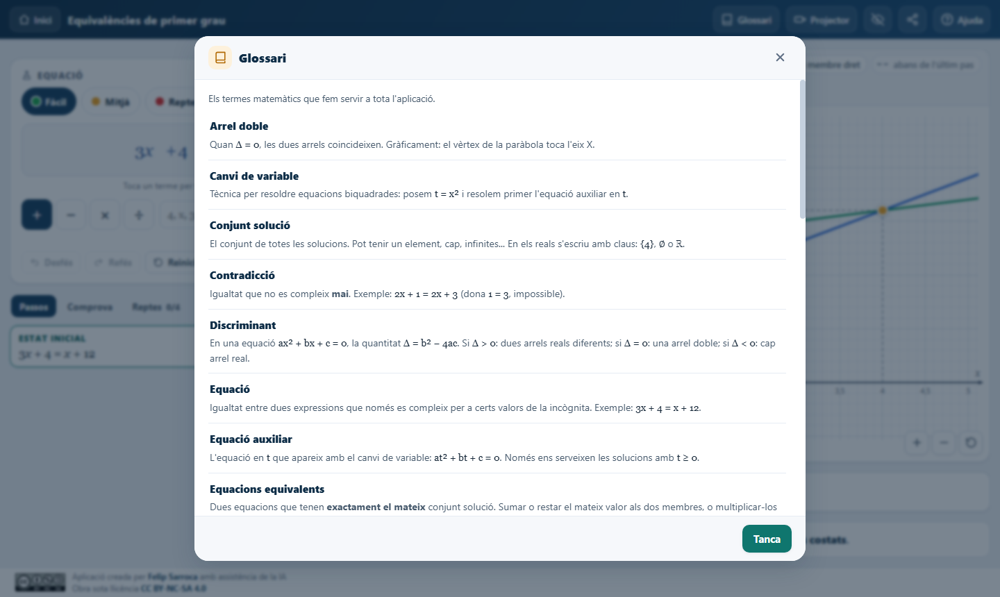
</p>

### També al mòbil

A pantalles petites, cada laboratori es divideix en dues pestanyes: els controls i la visualització.

<p align="center">
  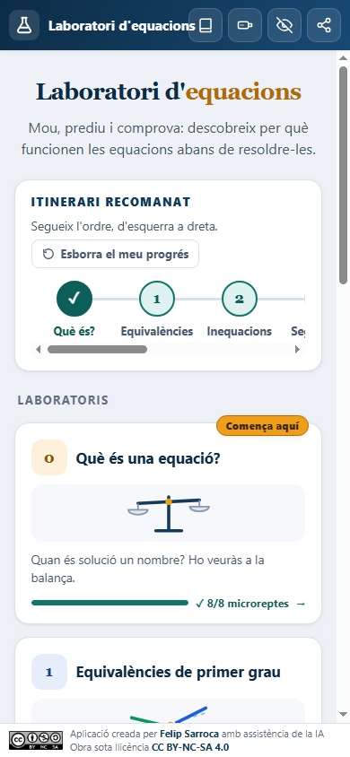
  &nbsp;&nbsp;
  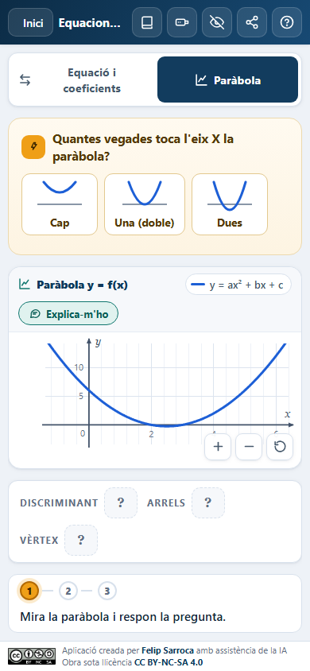
</p>

### Accessibilitat

- Tots els botons, xips i etiquetes de color tenen un contrast de com a mínim **4,5:1**, que és el nivell AA de les WCAG.
- Es pot fer servir amb el teclat. Les finestres retenen el focus i es tanquen amb `Esc`.
- La solució no es comunica mai només amb el color: sempre hi ha també un text o un símbol (✓, ≠, cercle obert o ple).

## Com fer-la servir a l'aula

### Sessió d'introducció (50 minuts)

| Temps | Activitat | Agrupament |
|---|---|---|
| 5 min | **M0**: a la pissarra digital, en mode projector, el grup prediu el valor de *x* que equilibra la balança | Gran grup |
| 15 min | **M1**: en parelles, resoldre els 4 reptes i explicar per què la solució no canvia | Parelles |
| 15 min | **M2**: descobrir quan s'inverteix el signe. Cal arribar a formular la regla amb paraules pròpies | Parelles |
| 10 min | **Detectiu**: tres casos per parelles, amb la justificació escrita | Parelles |
| 5 min | Posada en comú amb l'opció d'amagar respostes activada | Gran grup |

### Idees d'ús

- **Rutina d'inici de classe**: un cas del Detectiu projectat, amb la pregunta «On és l'error?».
- **Atenció a la diversitat**: «Explica-m'ho» en veu alta i el glossari per a l'alumnat nouvingut. Els reptes i el nivell *aprofundeix* de la Pràctica serveixen per a qui avança més de pressa.
- **Google Classroom**: configura una equació, fes clic a la icona **Comparteix** de la capçalera i penja l'enllaç com a tasca.
- **Avaluació formativa**: les barres de progrés de la pantalla d'inici donen una visió ràpida del que ha fet cada alumne.

## Publicar-la a GitHub Pages

1. Crea un repositori nou a GitHub, per exemple `laboratori-equacions`.
2. Puja-hi tot el contingut d'aquesta carpeta. Pots arrossegar els fitxers a la web de GitHub o fer servir git:

   ```bash
   git init
   git add .
   git commit -m "Laboratori d'equacions"
   git branch -M main
   git remote add origin https://github.com/USUARI/laboratori-equacions.git
   git push -u origin main
   ```

3. Al repositori, ves a **Settings → Pages → Build and deployment → Source: Deploy from a branch**. Tria la branca `main` i la carpeta `/ (root)`, i desa.
4. Al cap d'un minut, l'app estarà disponible a `https://USUARI.github.io/laboratori-equacions/`.

> 💡 També funciona si obres `index.html` directament des de l'ordinador o des d'un llapis de memòria, i a qualsevol servidor web estàtic.

## Estructura del codi

```
index.html            carcassa de l'app i peu de pàgina
assets/               distintiu de la llicència
docs/captures/        captures de pantalla d'aquest README
css/base.css          colors, tipografia, capçalera, inici i itinerari
css/components.css    botons, finestres, prediccions, detectiu i pràctica
css/math.css          fraccions, radicals, termes clicables i fórmules
css/labs.css          disposicions de cada laboratori
js/rational.js        aritmètica exacta amb racionals (BigInt) i radicals
js/poly.js            polinomis amb coeficients racionals
js/solver.js          resolució i classificació exactes de cada família
js/parse.js           lectura segura de les entrades (sense eval)
js/fmt.js             fórmules en HTML accessible
js/graph.js           gràfics SVG: desplaçament, zoom, franges i escala 1:1
js/numberline.js      recta numèrica i balança animada
js/components.js      finestres, avisos, prediccions i «Explica-m'ho»
js/app.js             navegació, itinerari, progrés, glossari i modes
js/lab0.js … lab5.js  els sis laboratoris
js/detectiu.js        detectiu d'errors
js/practica.js        pràctica graduada
```

L'app no fa servir cap biblioteca externa ni cal compilar-la: és HTML, CSS i JavaScript sense frameworks.

## Privacitat

- No cal cap registre ni es recull cap dada personal.
- Només es desen al **navegador de l'alumne** (`localStorage`) les preferències de pantalla, el progrés dels laboratoris i el resum de la pràctica.
- El botó **Esborra el meu progrés** de la pantalla d'inici elimina aquestes dades.
- La lectura en veu alta fa servir la veu del sistema operatiu.

## Referències curriculars

L'aplicació treballa els sabers del **sentit algebraic** de 4t d'ESO que estableix el [Decret 175/2022](https://xtec.gencat.cat/ca/curriculum/eso/curriculum-175-2022/) d'ordenació dels ensenyaments de l'educació bàsica a Catalunya, desplegament de la LOMLOE:

- Equacions de primer i segon grau, i equacions biquadrades.
- Inequacions de primer grau i la seva representació a la recta.
- Sistemes d'equacions lineals amb dues incògnites: resolució algebraica i interpretació gràfica.
- Relació entre la representació algebraica i la gràfica.

També hi són presents les competències de **resolució de problemes**, **raonament i prova** (prediu, justifica i comprova), **connexions** (àlgebra ↔ gràfic ↔ recta) i **comunicació** (explicar amb paraules pròpies).

## Autoria i llicència

<a href="https://creativecommons.org/licenses/by-nc-sa/4.0/deed.ca"></a>

Aplicació creada per **[Felip Sarroca](https://ja.cat/felipsarroca)** amb assistència de la IA.
Obra sota llicència **[CC BY-NC-SA 4.0](https://creativecommons.org/licenses/by-nc-sa/4.0/deed.ca)**: pots compartir-la i adaptar-la sense finalitat comercial, sempre que en citis l'autoria i comparteixis les adaptacions amb la mateixa llicència.
