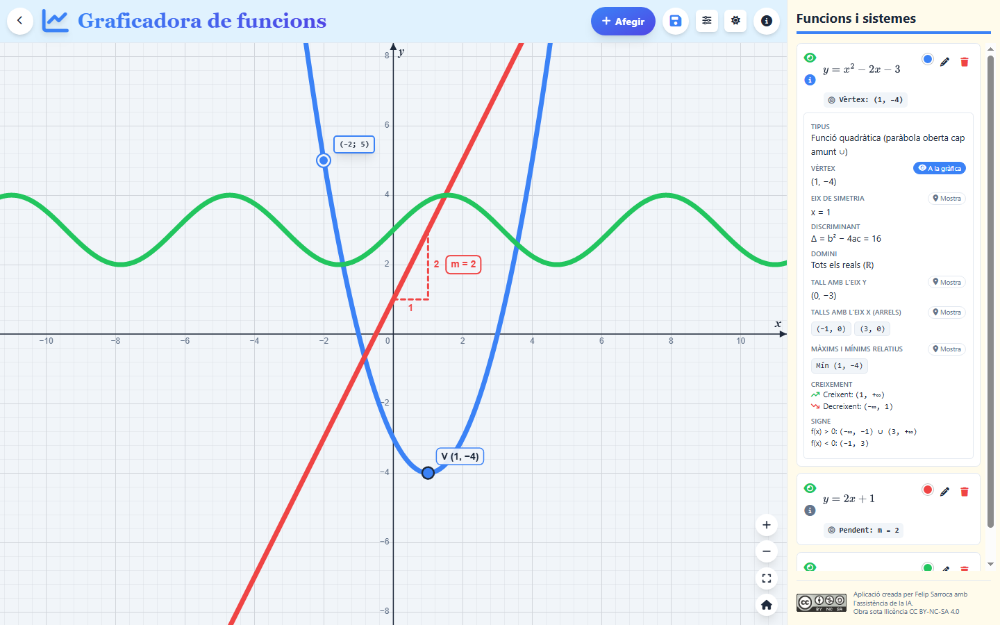
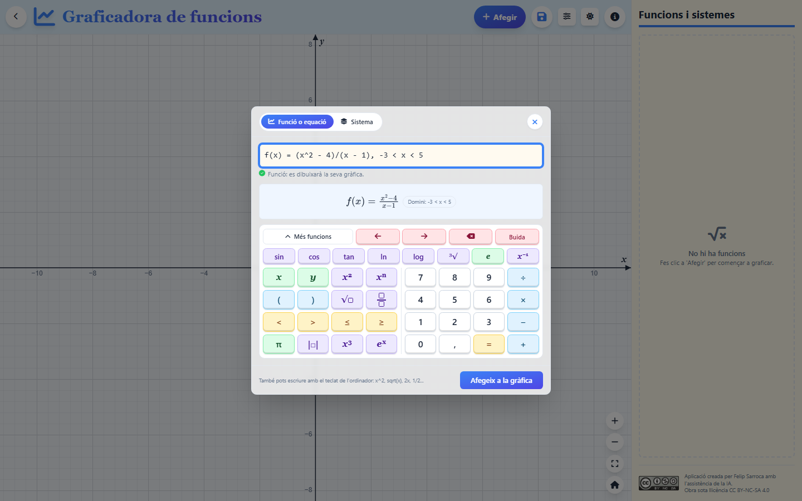
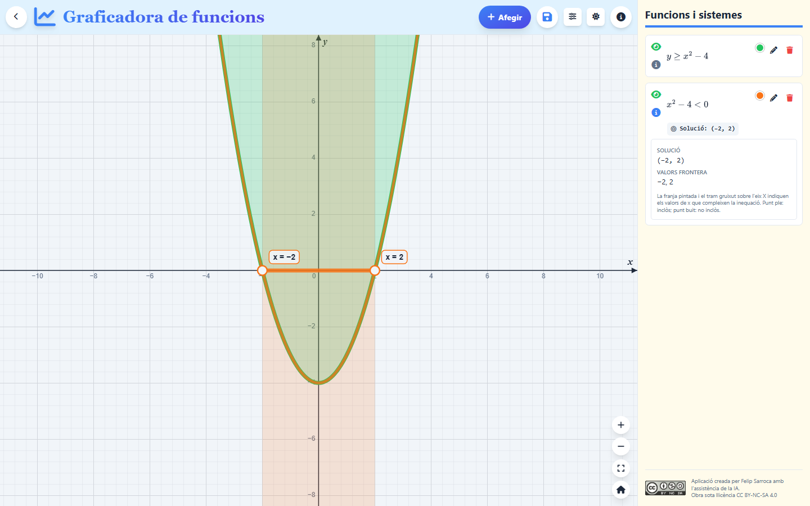
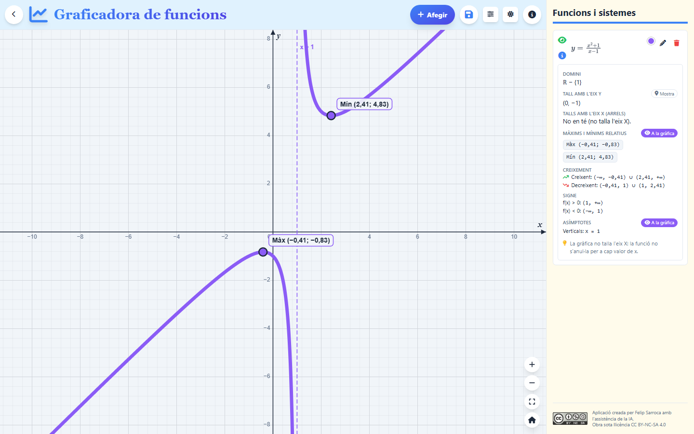
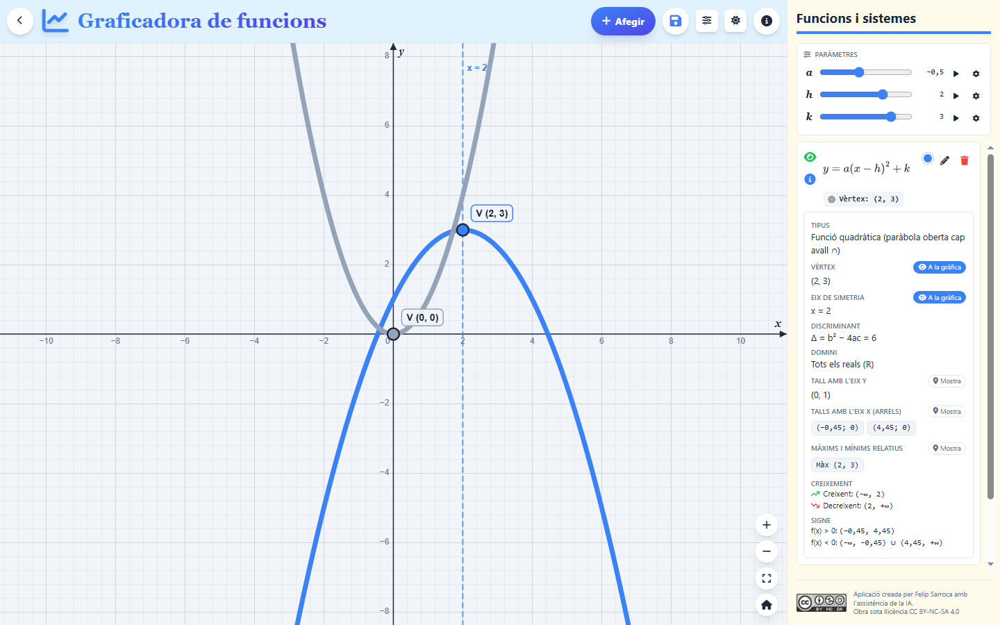
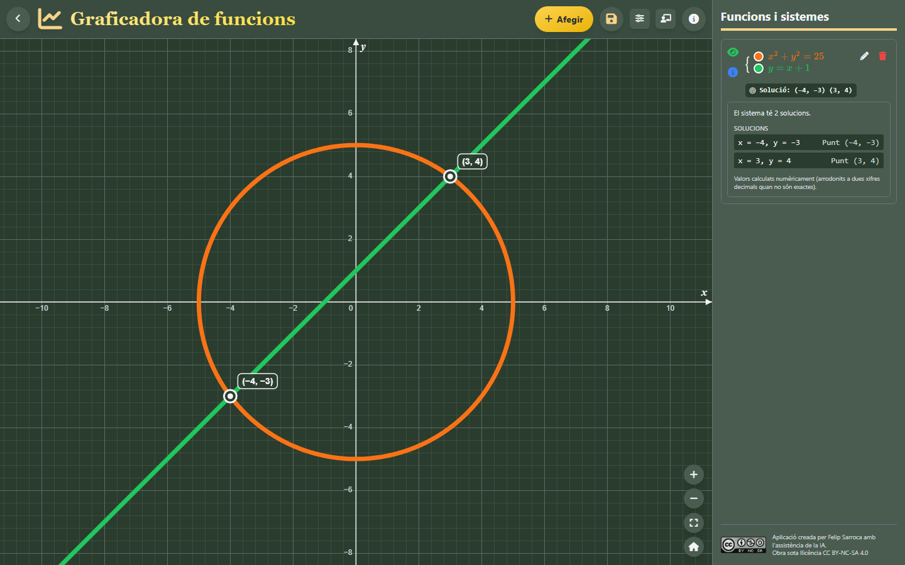
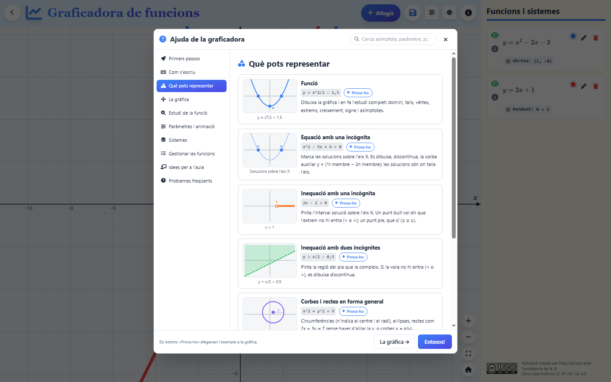
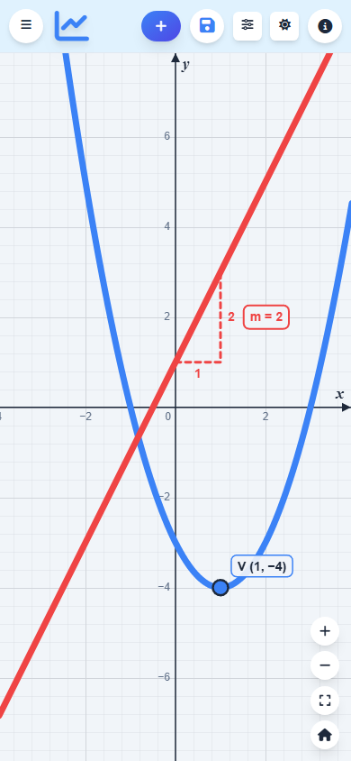
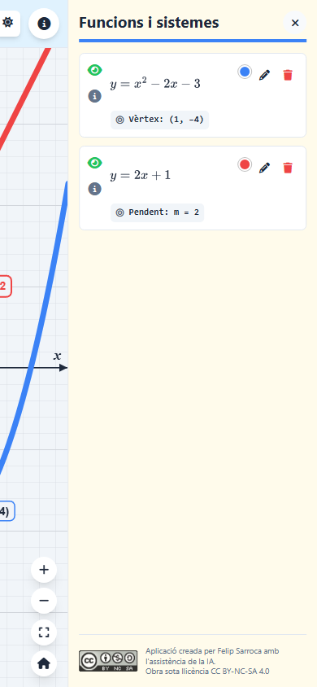

<div align="center">

# 📈 Graficadora de funcions

Aplicació web en català per representar funcions, equacions, inequacions i sistemes, i descobrir-ne les característiques




**[▶ Obre l'aplicació](https://felipsarroca.github.io/edu-apps/GraphMath/)**

</div>

---

## Índex

1. [Què és](#què-és)
2. [Primers passos](#primers-passos)
3. [Què pots representar](#què-pots-representar)
4. [Com s'escriu](#com-sescriu)
5. [La gràfica](#la-gràfica)
6. [Estudi de la funció](#estudi-de-la-funció)
7. [Paràmetres i animació](#paràmetres-i-animació)
8. [Sistemes](#sistemes)
9. [Ajuda integrada](#ajuda-integrada)
10. [Idees per a l'aula](#idees-per-a-laula)
11. [Accés i execució](#accés-i-execució)
12. [Estructura del codi](#estructura-del-codi)
13. [Privacitat](#privacitat)
14. [Limitacions conegudes](#limitacions-conegudes)
15. [Referències curriculars](#referències-curriculars)
16. [Autoria i llicència](#autoria-i-llicència)

---

## Què és

La **Graficadora de funcions** dibuixa el que s'escriu tal com es faria a mà —funcions, equacions, inequacions, corbes i sistemes— i n'explica les característiques: talls amb els eixos, vèrtex, pendent, màxims i mínims, creixement, signe, asímptotes i discontinuïtats.

Està pensada per a dos usos:

- 👩‍🏫 **El professorat**, per mostrar funcions a l'aula de manera àgil: lliscadors animats per als paràmetres, elements que es destaquen amb un clic, vista que s'ajusta sola i captures en alta resolució per a fitxes i presentacions.
- 🧑‍🎓 **L'alumnat**, per provar funcions i equacions i aprendre'n: el punter segueix la corba i en dona les coordenades exactes, l'estudi s'actualitza a l'instant i, quan una equació no té solució, una explicació breu en diu el motiu.

Altres característiques:

- 🖥️ Funciona en ordinador, tauleta, mòbil i pissarra digital, amb quatre temes de color: clar, fosc, pissarra i alt contrast.
- 🧮 Els resultats exactes es mostren com a enters, fraccions o múltiples de π; els aproximats porten el signe ≈.
- 💾 Tot es desa automàticament al navegador: funcions, paràmetres i opcions de vista.

## Primers passos

1. Prem **«+ Afegir»**. S'obre l'editor.
2. **Escriu l'expressió** amb el teclat de l'ordinador o amb el de l'editor. A sota veuràs si s'ha entès (✓ verd) o què cal corregir, i una previsualització ben escrita.
3. Prem **«Afegeix a la gràfica»** o Retorn. La vista s'ajusta sola perquè se'n vegin els punts importants.
4. **Explora-la**: passa el ratolí (o el dit) per sobre de la corba i obre ⓘ a la seva targeta per veure'n l'estudi complet.



L'editor separa sol el domini quan s'escriu a la mateixa línia (`f(x) = (x² − 4)/(x − 1), −3 < x < 5`) i avisa dels paràmetres que trobarà. El teclat té les tecles agrupades per colors: variables, plantilles (x², √, fracció, |□|…), relacions, operacions i control del cursor. El botó «Més funcions» hi afegeix sin, cos, tan, ln, log, ∛, e i x⁻¹.

## Què pots representar

| Tipus | Exemple | Què fa l'aplicació |
|---|---|---|
| **Funció** | `y = x^2 − 2x − 3` | Dibuixa la gràfica i en fa l'estudi complet. Marca el vèrtex de les paràboles i el triangle del pendent de les rectes. |
| **Equació amb una incògnita** | `x^2 − 5x + 6 = 0` | Marca les solucions sobre l'eix X i dibuixa la paràbola o corba auxiliar y = (1r membre − 2n membre). |
| **Inequació amb una incògnita** | `x^2 − 4 < 0` | Pinta l'interval solució sobre l'eix X. Punt ple: l'extrem hi entra; punt buit: no hi entra. |
| **Inequació amb dues incògnites** | `y ≥ x^2 − 4` | Pinta la regió del pla que la compleix. |
| **Rectes i corbes en forma general** | `2x + 3y = 7`, `x^2 + y^2 = 9` | Les dibuixa sense haver d'aïllar la y. De les circumferències, n'indica el centre i el radi. |
| **Interval** | `−1 < x < 1,5` | Pinta la franja vertical corresponent. |
| **Sistema** | `{ x^2 + y^2 = 25 ; y = x + 1 }` | Cada equació amb el seu color i els punts solució marcats. |



## Com s'escriu

| Què | S'escriu | Exemple |
|---|---|---|
| Potència | `^`, `²`, `³` | `x^2`, `2^x`, `x^(1/3)` |
| Producte | sense signe, o amb `·` o `*` | `2x`, `3(x+1)` |
| Fracció | `/` amb parèntesis | `(x+1)/(x−2)` |
| Arrels | `sqrt`, `√`, `∛`, `cbrt` | `√(x+4)` |
| Valor absolut | `\| \|` o `abs` | `\|x − 2\|` |
| Trigonometria (en radiants) | `sin` (o sen), `cos`, `tan` (o tg), `arcsin`… | `2sin(x)` |
| Logaritmes | `ln`, `log` (base 10), `log(x, b)` | `log(x, 2)` |
| Exponencial | `e^` o `exp` | `e^(−x)` |
| Constants | `π` (o pi) i `e` | `y = πx` |
| Decimals | amb coma o amb punt | `2,5x`, `2.5x` |
| Desigualtats | `<`, `>`, `≤`, `≥` (o `<=`, `>=`) | `y ≥ x² − 1` |
| Nom de funció | `f(x) =`, `g(x) =`… | `f(x) = 3x − 1` |
| Domini restringit | després d'una coma o d'un punt i coma | `y = x², −2 < x < 2` |
| Paràmetres | qualsevol de `a b c d h k m n p q r s t u v w` | `y = a(x − h)^2 + k` |

> ⚠️ Compte amb els parèntesis: `1/x − 2` no és el mateix que `1/(x − 2)`. La previsualització de l'editor ajuda a comprovar-ho.

## La gràfica

| Per… | Amb ratolí | En pantalla tàctil |
|---|---|---|
| Desplaçar-te | Arrossega | Arrossega amb un dit (lluny de les corbes) |
| Apropar o allunyar | Roda del ratolí o botons + i − | Pessiga amb dos dits |
| Llegir coordenades | Passa el punter per sobre de la corba | Toca la corba i llisca-hi el dit |
| Veure-ho tot | Botó ⤢: ajusta la vista a les funcions | Igual |
| Tornar a començar | Botó ⌂: vista inicial | Igual |

- **Seguir la corba.** El punter s'enganxa a la corba més propera i avança per valors rodons de x segons el zoom (de 0,1 en 0,1 amb el zoom normal). La y es calcula exactament en aquell valor: a x = 4 de y = x² − 3x + 2 es llegeix (4; 6). Prop d'un punt destacat, el punter s'hi enganxa i en mostra l'etiqueta.
- **Menú de vista.** Amaga la quadrícula, els nombres dels eixos o les etiquetes dels punts, i canvia l'escala de l'eix Y (de ×0,01 a ×10) per a funcions que creixen molt o variacions petites.
- **Ajust automàtic.** En afegir o editar una funció, la vista s'encaixa perquè se'n vegin els punts importants i, si cal, tria una escala de l'eix Y adequada.
- **Captura en alta resolució.** El botó de desar genera un PNG tres o quatre vegades més gran que la pantalla, amb la llegenda de les expressions. Queda nítid en documents, presentacions, el Classroom o imprès.

## Estudi de la funció

En prémer ⓘ a la targeta d'una funció s'obre el seu estudi, que s'actualitza sol quan es mou un paràmetre:

| Apartat | Què indica |
|---|---|
| **Tipus i coeficients** | Funció lineal, quadràtica…; pendent i ordenada a l'origen de les rectes; discriminant de les paràboles |
| **Domini** | Valors de x per als quals la funció existeix: ℝ − {2}, [0, +∞)… |
| **Talls amb els eixos** | f(0) i les arrels, exactes quan és possible |
| **Vèrtex i eix de simetria** | En les paràboles; el vèrtex es marca a la gràfica automàticament |
| **Màxims i mínims relatius** | Punts on la funció passa de créixer a decréixer o al revés |
| **Creixement** | Intervals de creixement i de decreixement |
| **Signe** | Intervals on f(x) > 0 i on f(x) < 0 |
| **Asímptotes** | Verticals i horitzontals, indicant si l'horitzontal és quan x → +∞ o x → −∞ |
| **Discontinuïtats evitables** | Els «forats», dibuixats com a punt buit: (x² − 4)/(x − 2) a (2, 4) |
| **Arrels periòdiques** | En les trigonomètriques: … −π, 0, π, 2π … i la forma general x = kπ (k ∈ ℤ) |
| **Explicacions** | Per què una equació no té solució, en té infinites o una funció no talla l'eix X |

El botó **«Mostra»** de cada apartat destaca aquell element a la gràfica: eix de simetria, talls, màxims i mínims o asímptotes. El vèrtex de les paràboles i el triangle del pendent de les rectes ja hi surten marcats.



## Paràmetres i animació

Qualsevol lletra que no sigui x ni y es converteix en un **paràmetre**, i a dalt del panell lateral apareix un lliscador per canviar-ne el valor. La gràfica i l'estudi s'actualitzen a l'instant. Si dues funcions fan servir la mateixa lletra, comparteixen lliscador.

- ▶ **Anima** el paràmetre: va i ve sol entre el mínim i el màxim.
- ⚙ Tria el **mínim, el màxim i el pas** (per defecte, de −5 a 5 de 0,1 en 0,1).

Famílies per explorar: `y = mx + n`, `y = a(x − h)^2 + k`, `y = ax^2 + bx + c`, `y = a sin(bx)`, `y = a^x`, `(x − a)^2 + (y − b)^2 = r^2`.



## Sistemes

A l'editor, la pestanya **«Sistema»** permet escriure una equació a cada línia (dues o més). Cada equació es dibuixa d'un color i les solucions apareixen com a punts, a la gràfica i a la targeta.

- Els sistemes **lineals** es resolen de manera exacta i se'n diu el tipus: compatible determinat, incompatible (rectes paral·leles) o compatible indeterminat (la mateixa recta).
- Els **no lineals** (paràboles, circumferències…) es resolen numèricament.



## Ajuda integrada

El botó ⓘ de la capçalera obre una ajuda completa, organitzada en deu temes: primers passos, com s'escriu, què pots representar, la gràfica, estudi de la funció, paràmetres, sistemes, gestió de les funcions, idees per a l'aula i problemes freqüents.

- 🔎 **Cercador** per trobar un tema escrivint-ne una paraula («asímptota», «zoom»…).
- 🖼️ **Il·lustracions** per a cada concepte i **desplegables** per no carregar la pantalla.
- ▶ **Botons «Prova-ho»** que afegeixen l'exemple a la gràfica directament.



## Idees per a l'aula

- **Predir abans de veure.** Escriu la funció, amaga-la amb l'ull i demana que en prediguin la forma, els talls o el vèrtex. Després mostra-la i obre l'estudi per comprovar-ho.
- **Què fa cada paràmetre?** Amb `y = a(x − h)^2 + k`, anima un paràmetre cada vegada i demana que formulin la regla.
- **Lectura de gràfiques.** Amaga els nombres dels eixos o les etiquetes dels punts i demana que estimin coordenades, extrems o intervals. Després es comproven amb el punter.
- **Resolució gràfica.** Compara la solució algebraica amb la gràfica: una equació de segon grau amb Δ < 0 no talla l'eix X; un sistema incompatible són dues rectes paral·leles.
- **Inequacions i signe.** Escriu `x² − 4 ≥ 0` i `y = x² − 4` alhora: l'interval solució és on la paràbola queda per sobre de l'eix X.
- **Modelització.** Planteja una situació real (una tarifa, un creixement, un descompte) i deixa que l'alumnat proposi el model amb paràmetres i l'ajusti amb els lliscadors.

<div align="center">

&nbsp;&nbsp;&nbsp;

*També funciona en mòbils i tauletes.*

</div>

## Accés i execució

- **App a GitHub Pages:** <https://felipsarroca.github.io/edu-apps/GraphMath/>
- **Codi font:** <https://github.com/felipsarroca/edu-apps/tree/main/GraphMath>

No cal instal·lar res ni compilar: totes les biblioteques són a la carpeta `vendor`. Per executar-la localment cal servir la carpeta amb un servidor web estàtic, perquè el navegador no carrega els mòduls JavaScript des de `file://`. Per exemple:

```bash
cd GraphMath
python -m http.server 8000
```

i obrir <http://localhost:8000>.

> Si després d'una actualització no apareixen les novetats, recarrega la pàgina amb **Ctrl + F5** (o **Cmd + Maj + R** a Mac).

## Estructura del codi

```
index.html                       carcassa, mapa d'importacions i càrrega de MathJax
index.js                         punt d'entrada de React
App.js                           estat global: funcions, paràmetres, vista i desament
constants.js                     colors, temes i elements destacats per defecte
services/parser.js               analitzador propi: text → arbre → funció, LaTeX i polinomi (sense eval)
services/mathService.js          classificació, arrels, sistemes, domini, extrems, asímptotes i formatació
components/Graph.js              llenç: dibuix, zoom, desplaçament, punter i captura en alta resolució
components/EquationEditorModal.js  editor amb validació en directe i domini en línia
components/MathKeyboard.js       teclat matemàtic
components/MathExpression.js     fórmules amb MathJax
components/SidePanel.js          targetes i estudi de cada funció
components/ParametersPanel.js    lliscadors i animació dels paràmetres
components/ViewMenu.js           menú de vista i escala de l'eix Y
components/InfoModal.js          ajuda integrada amb il·lustracions
components/Header.js             capçalera
components/ThemeSwitcher.js      canvi de tema
vendor/                          React, Tailwind, MathJax, Font Awesome i d3, en local
docs/captures/                   captures de pantalla d'aquest README
```

## Privacitat

- No cal cap registre ni es recull cap dada personal.
- Tot es desa només al **navegador** (`localStorage`): les funcions, els paràmetres, les opcions de vista i l'últim tema de l'ajuda consultat.
- Si s'esborren les dades del lloc al navegador o es canvia de dispositiu, les funcions no hi seran. Per conservar una gràfica, es pot desar com a imatge.

## Limitacions conegudes

- L'estudi és **numèric**: les arrels i els extrems es busquen entre x = −100 i x = 100. Fora d'aquest interval, o en funcions molt irregulars, pot no trobar-los tots.
- Detecta asímptotes verticals i horitzontals, però **no les obliqües**.
- Les funcions trigonomètriques treballen en **radiants**.

## Referències curriculars

L'aplicació dona suport als sabers del **sentit algebraic** i de les **funcions** de l'ESO i del Batxillerat que estableixen el [Decret 175/2022](https://xtec.gencat.cat/ca/curriculum/eso/curriculum-175-2022/) (educació bàsica) i el Decret 171/2022 (Batxillerat) a Catalunya, desplegament de la LOMLOE:

- Representació i interpretació de funcions lineals, afins, quadràtiques, de proporcionalitat inversa, exponencials, logarítmiques i trigonomètriques.
- Característiques d'una funció: domini, talls amb els eixos, creixement, extrems, signe, asímptotes i continuïtat.
- Resolució gràfica d'equacions, inequacions i sistemes.
- Estudi de famílies de funcions a partir dels seus paràmetres.

També hi són presents les competències de **raonament i prova** (predir i comprovar), **connexions** (expressió algebraica ↔ gràfica ↔ taula de característiques) i **comunicació**.

## Autoria i llicència

<a href="https://creativecommons.org/licenses/by-nc-sa/4.0/deed.ca"></a>

Aplicació creada per **[Felip Sarroca](https://ja.cat/felipsarroca)** amb assistència de la IA.
Obra sota llicència **[CC BY-NC-SA 4.0](https://creativecommons.org/licenses/by-nc-sa/4.0/deed.ca)**: pots compartir-la i adaptar-la sense finalitat comercial, sempre que en citis l'autoria i comparteixis les adaptacions amb la mateixa llicència.
