# Laboratori d'igualació d'equacions

Aplicació web per aprendre a igualar equacions químiques amb models moleculars, gràfics de barres i balances. Està pensada per a l'alumnat d'ESO i té un nivell opcional de batxillerat amb reaccions redox iòniques.

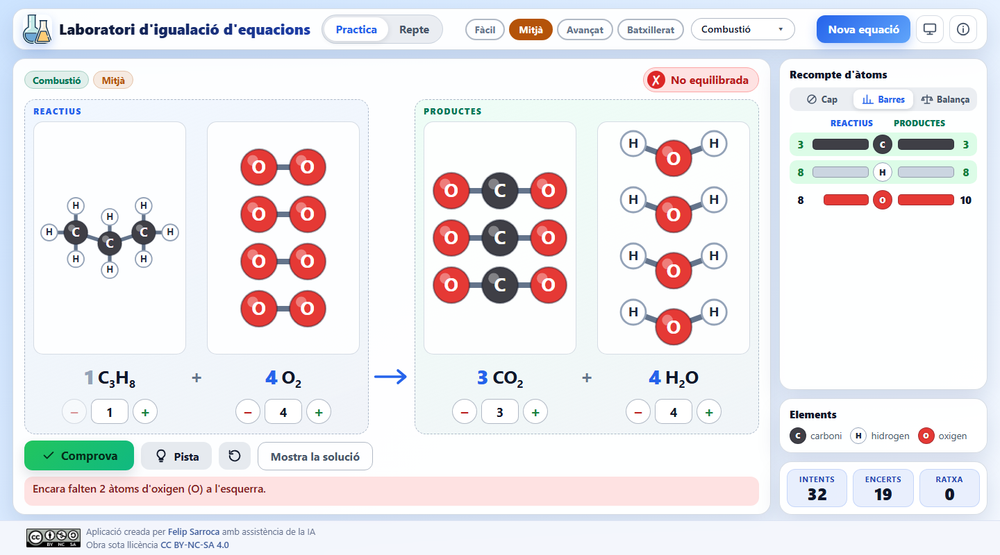

## Índex

- [Què ofereix](#què-ofereix)
- [Com funciona](#com-funciona)
- [Ajudes visuals](#ajudes-visuals)
- [Pistes i comprovació](#pistes-i-comprovació)
- [Mode Repte](#mode-repte)
- [Guia del laboratori](#guia-del-laboratori)
- [Adaptació a la pantalla](#adaptació-a-la-pantalla)
- [Ús a l'aula](#ús-a-laula)
- [Estructura del projecte](#estructura-del-projecte)
- [Execució local](#execució-local)
- [Afegir o modificar equacions](#afegir-o-modificar-equacions)
- [Llicència](#llicència)

## Què ofereix

- **91 equacions verificades** en quatre nivells:

  | Nivell | Equacions | Contingut |
  |---|---|---|
  | Fàcil | 32 | 2 o 3 substàncies i coeficients petits |
  | Mitjà | 37 | 4 substàncies o més, grups entre parèntesis |
  | Avançat | 13 | Coeficients grans i fins a 6 substàncies |
  | Batxillerat | 9 | Redox amb ions: cal igualar també la càrrega |

- **Set tipus de reacció**, que es poden filtrar: síntesi, descomposició, combustió, substitució simple, substitució doble, neutralització i oxidació-reducció.
- **Context real** per a cada equació. Es mostra quan s'encerta: airbag, rovell, antiàcids, pluja àcida, fotosíntesi, gasolina, butà…
- **Models moleculars** amb els colors CPK i el símbol dins de cada àtom:
  - les molècules orgàniques es dibuixen en cadena;
  - les sals, com a xarxa iònica;
  - els ions, amb la seva càrrega.
- **Dos modes**: Practica (lliure, amb pistes i solució) i Repte (5 equacions puntuades).
- **Guia integrada** amb un exemple resolt pas a pas, les regles d'or, els tipus de reacció i el progrés de l'alumne.
- **Sense dependències ni registre**: no cal cap compte i tot es desa al navegador.

## Com funciona

Cada substància ocupa una columna. A dalt hi ha les seves molècules, al mig la fórmula i a sota el coeficient, que es canvia amb els botons [−] i [+] o escrivint-lo. Les molècules es multipliquen a mesura que puja el coeficient, de manera que l'alumne *veu* que posar un 2 davant de H₂O vol dir tenir dues molècules d'aigua.

Quan l'equació està igualada, l'app ho celebra i explica on es dona aquesta reacció a la vida real:

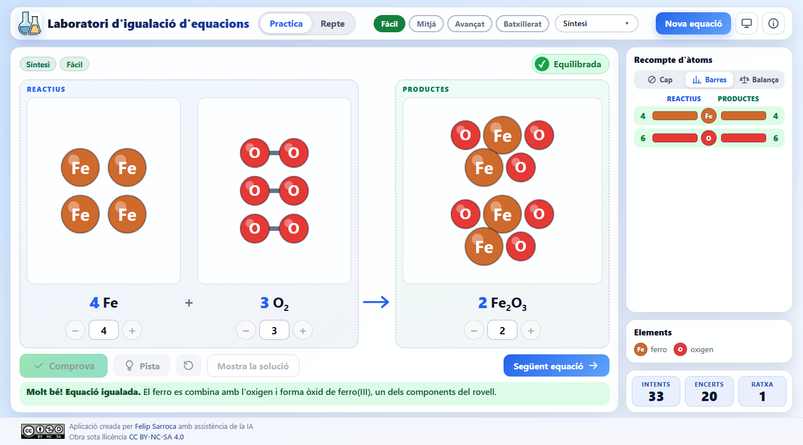

## Ajudes visuals

El tauler de la dreta té tres opcions, que es poden canviar en qualsevol moment:

| Ajuda | Què mostra | Quan fer-la servir |
|---|---|---|
| **Cap** | Només les molècules | Quan l'alumne ja compta els àtoms tot sol |
| **Barres** | Una barra per a reactius i una per a productes, per a cada element. Es tornen verdes quan quadren | Per començar i en equacions llargues |
| **Balança** | Una balança per element, que es decanta cap al costat amb més àtoms | Per entendre la idea de conservació de la massa |

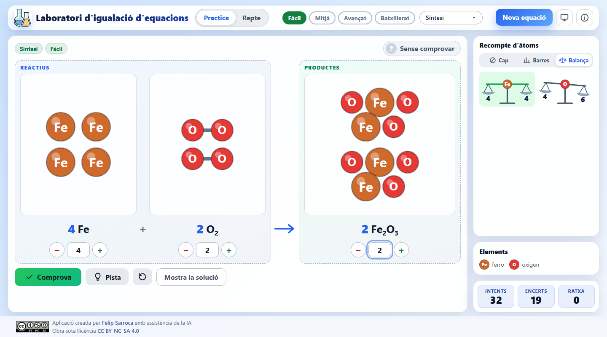

En el nivell de batxillerat, apareix també una fila per a la **càrrega** total de cada costat:

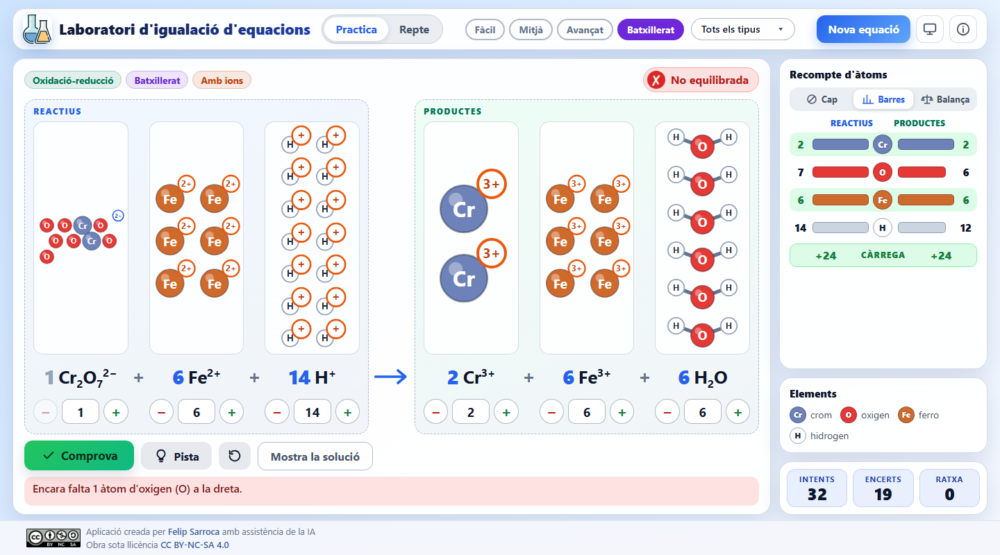

## Pistes i comprovació

- **Comprovació en dos temps.** L'estat «Equilibrada» no apareix fins que es prem «Comprova» (o la tecla Retorn). Així l'alumne ha de decidir quan creu que ha acabat.
- **Missatges concrets**, per exemple:
  - «Encara falten 2 àtoms d'oxigen (O) a l'esquerra»;
  - avís quan els coeficients es poden simplificar (4, 2, 4 → 2, 1, 2);
  - avís quan els àtoms quadren però la càrrega no.
- **Pistes en tres passos**, de menys a més ajuda:
  1. quin element no quadra;
  2. quina substància cal canviar (es ressalta en taronja);
  3. quin valor es pot provar.

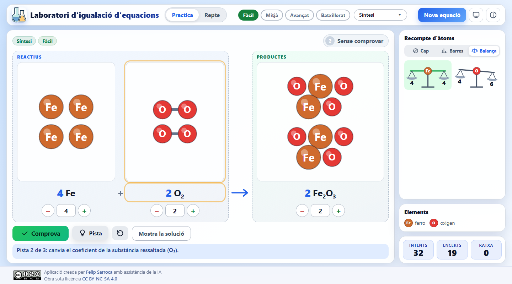

- **Mostra la solució**: l'equació resolta així no compta com a encert i la ratxa torna a zero. En el mode Repte, demana confirmació i l'equació val 0 punts.

## Mode Repte

- 5 equacions dels nivells i tipus triats, sense repeticions.
- 2 intents per equació: 2 punts si s'encerta a la primera i 1 punt a la segona.
- Sense pistes, amb cronòmetre opcional.
- En acabar, es mostra la puntuació en estrelles.

| Durant el repte | Resultat final |
|---|---|
| 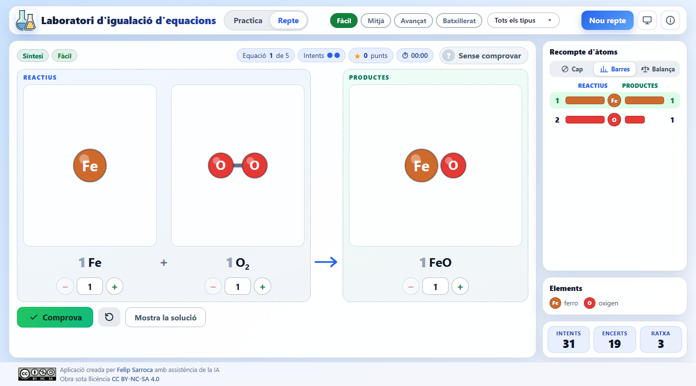 | 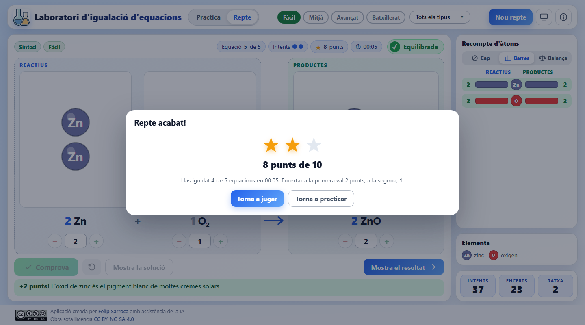 |

## Guia del laboratori

El botó **ⓘ** obre una guia amb tres pestanyes.

### Com s'iguala

Un exemple resolt pas a pas (H₂ + O₂ → H₂O), amb les molècules i el recompte d'àtoms de cada pas, i les regles d'or:

- canviar coeficients, mai subíndexs;
- fer servir nombres enters i tan petits com es pugui;
- començar per l'element que surt en menys substàncies;
- amb ions, igualar també la càrrega.

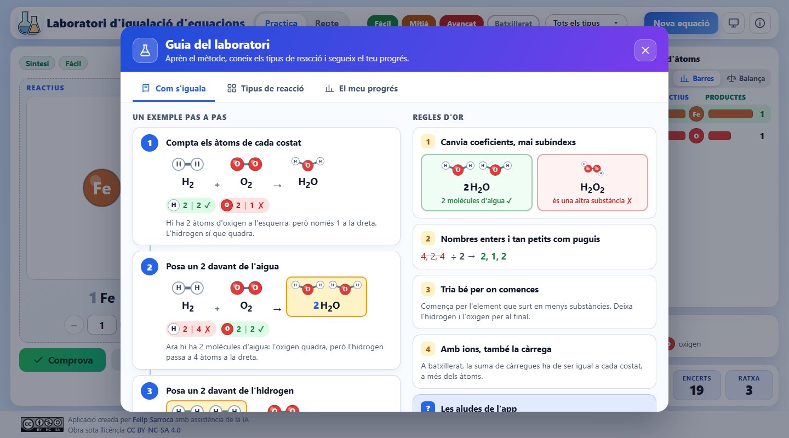

### Tipus de reacció

Cada tipus té un esquema amb fitxes de colors (A + B → AB…), una definició, un exemple igualat i el nombre d'equacions disponibles.

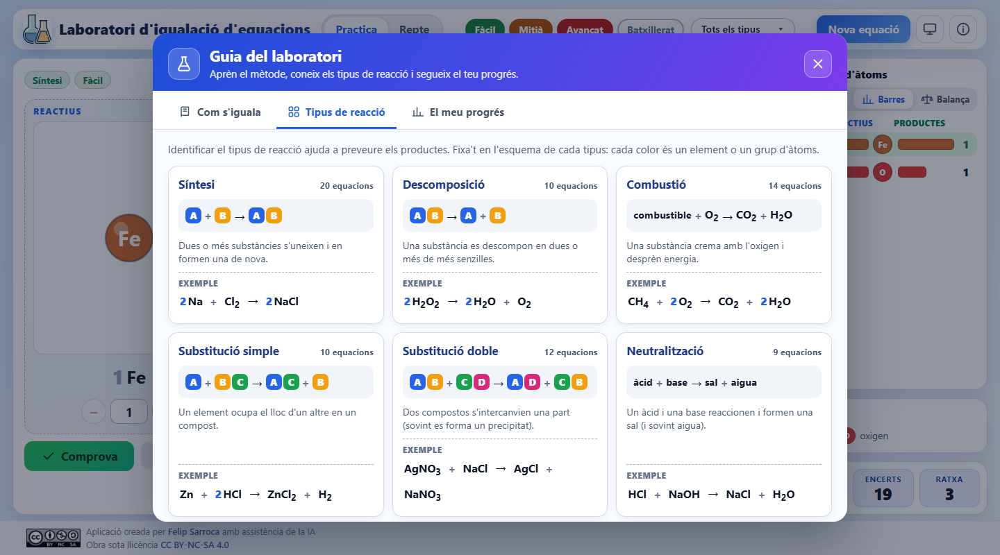

### El meu progrés

Aquesta pestanya mostra:

- les equacions resoltes, els encerts, els intents, la precisió i la millor ratxa;
- un anell de progrés per a cada nivell;
- una barra per a cada tipus de reacció.

Només compten les equacions resoltes sense mirar la solució.

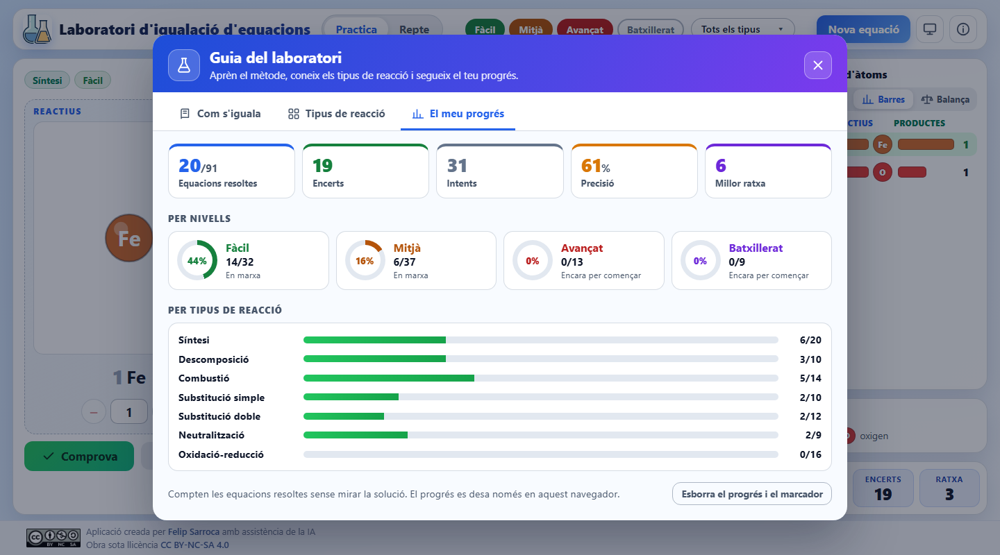

## Adaptació a la pantalla

La interfície està pensada per a 1440 × 800 px i s'escala automàticament amb la variable `--ui-zoom` (vegeu `fitScale` a `js/app.js`). Tota l'activitat cap en una sola pantalla, sense desplaçament, a:

- 1920 × 1080 (s'amplia);
- 1366 × 768 i 1366 × 740 (es redueix);
- escalat del sistema al 125 % i al 150 %;
- tauleta (1024 × 768).

Hi ha dos casos especials:

- **Mode projector** (botó de la pantalla): fa servir una base més petita i, per tant, tot es veu més gran a la pissarra digital. Amb les equacions molt llargues (6 substàncies o 5 elements), amplia una mica menys perquè tot hi càpiga.
- **Mòbil** (menys de 900 px d'amplada): la disposició passa a una columna amb desplaçament vertical.

| Mode projector | Mòbil |
|---|---|
| 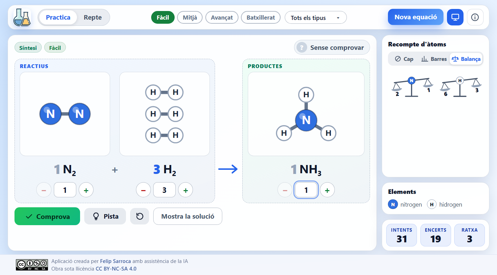 | 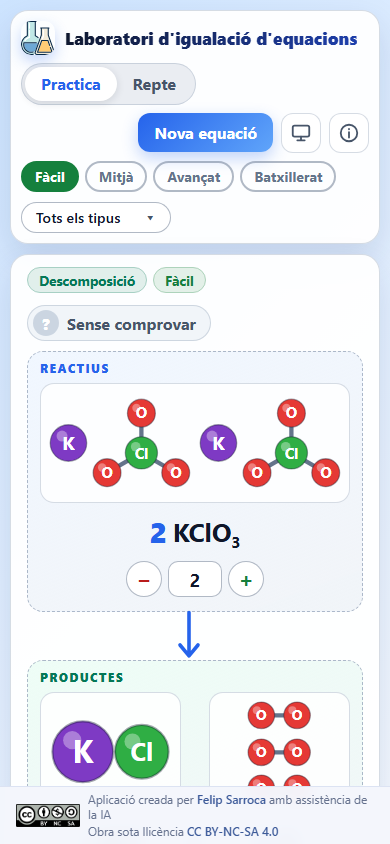 |

## Ús a l'aula

| Moment | Proposta |
|---|---|
| **Modelatge** | Amb el mode projector i la balança, resoleu una equació a la pissarra digital. Mostreu com es compensa cada element. Podeu seguir l'exemple pas a pas de la guia. |
| **Pràctica guiada** | L'alumnat treballa en parelles al nivell Fàcil amb les barres activades. Fa servir les pistes només quan les necessita. |
| **Autonomia** | Desactiveu l'ajuda visual («Cap») perquè l'alumnat compti els àtoms per si mateix. |
| **Avaluació formativa** | Cada alumne fa un Repte i lliura una captura del resultat a Google Classroom. La pestanya «El meu progrés» mostra els nivells i tipus que encara cal treballar. |
| **Atenció a la diversitat** | Filtreu per tipus de reacció o per nivell. Combineu la balança, que és molt visual, amb les pistes en tres passos. El nivell de batxillerat permet ampliar per a l'alumnat d'altes capacitats. |

Connexió curricular (LOMLOE, currículum de Catalunya, Física i Química d'ESO): la conservació de la massa i la representació de les reaccions químiques amb equacions igualades.

## Estructura del projecte

```text
IgualacioQuimica/
├── index.html                  # Estructura de la pàgina i diàlegs
├── css/styles.css              # Estils i adaptació a la pantalla
├── js/
│   ├── chem.js                 # Motor químic: fórmules, ions, càrregues, comprovació
│   ├── molecules.js            # Dibuix SVG de molècules i ions
│   └── app.js                  # Interfície, modes, ajudes visuals, guia i progrés
├── data/
│   ├── config.json             # Nivells, tipus de reacció (amb esquema i exemple) i fitxers de dades
│   ├── eq_nivell1.json         # Fàcil
│   ├── eq_nivell2.json         # Mitjà
│   ├── eq_nivell3.json         # Avançat
│   └── eq_batxillerat.json     # Batxillerat (redox amb ions)
├── scripts/valida-equacions.mjs  # Validació automàtica de les dades
├── docs/                       # Captures del README
├── assets/CC_BY-NC-SA.png      # Distintiu de la llicència
└── favicon.svg
```

No depèn de cap biblioteca externa i funciona sense connexió un cop carregada.

El progrés es desa al `localStorage` del navegador amb tres claus:

| Clau | Contingut |
|---|---|
| `iq_settings_v2` | Ajuda visual, filtres, mode projector, cronòmetre i darrera pestanya de la guia |
| `iq_stats_v2` | Intents, encerts, ratxa actual i millor ratxa |
| `iq_progress_v2` | Equacions resoltes |

## Execució local

Cal un servidor web estàtic, perquè el navegador no carrega els JSON des de `file://`. Des de la carpeta de l'app:

```bash
python -m http.server 8000
```

Després obriu `http://localhost:8000`.

## Afegir o modificar equacions

1. Editeu el fitxer del nivell corresponent dins de `data/`. Cada equació ocupa una línia:

   ```json
   {"id": "eq124", "reactants": ["Fe^2+", "MnO4^-", "H^+"], "products": ["Fe^3+", "Mn^2+", "H2O"], "coefficients": [5, 1, 8, 5, 1, 4], "type": "redox", "level": 4, "explanation": "Text que es mostra en encertar."}
   ```

   - Els subíndexs s'escriuen com a dígits: `H2O`, `Ca(OH)2`, `(NH4)2SO4`.
   - La càrrega s'escriu sempre amb `^`: `Fe^2+`, `MnO4^-`, `Cr2O7^2-`.
   - L'explicació no ha de donar la solució, perquè es mostra quan s'encerta.

2. Valideu les dades:

   ```bash
   node scripts/valida-equacions.mjs
   ```

   L'script comprova, per a cada equació:

   - que les fórmules s'interpreten bé;
   - que la solució quadra en àtoms i en càrrega;
   - que els coeficients són mínims;
   - que no ve igualada amb tots els coeficients a 1;
   - que la solució és única;
   - que el tipus i el nivell existeixen;
   - que no hi ha identificadors ni equacions repetits;
   - que les equacions amb ions són del nivell de batxillerat.

   També comprova que l'exemple de cada tipus de reacció de `config.json` estigui ben igualat.

## Llicència

[Creative Commons BY-NC-SA 4.0](https://creativecommons.org/licenses/by-nc-sa/4.0/deed.ca). Aplicació creada per [Felip Sarroca](https://ja.cat/felipsarroca) amb assistència de la IA.
