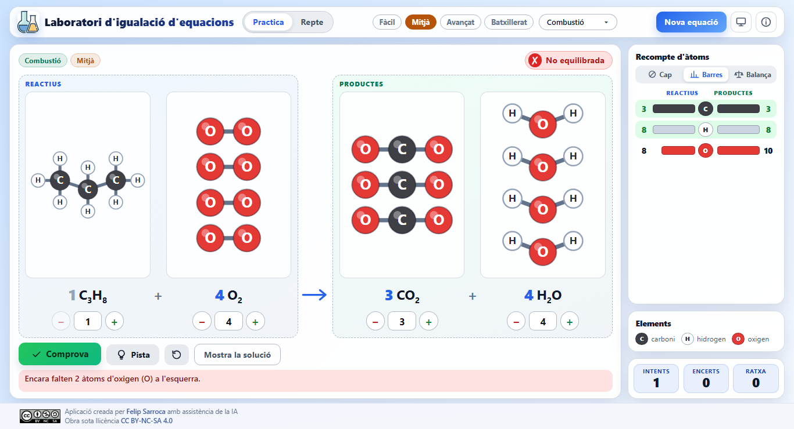

# Laboratori d'igualació d'equacions

Aplicació web per aprendre a igualar equacions químiques amb models moleculars, gràfics de barres i balances. Està pensada per a l'alumnat d'ESO i té un nivell opcional de batxillerat amb reaccions redox iòniques.



## Què ofereix

- **91 equacions verificades** en quatre nivells:

  | Nivell | Equacions | Contingut |
  |---|---|---|
  | Fàcil | 32 | 2 o 3 substàncies i coeficients petits |
  | Mitjà | 37 | 4 substàncies o més, grups entre parèntesis |
  | Avançat | 13 | Coeficients grans i fins a 6 substàncies |
  | Batxillerat | 9 | Redox amb ions: cal igualar també la càrrega |

- **Set tipus de reacció**: síntesi, descomposició, combustió, substitució simple, substitució doble, neutralització i oxidació-reducció.
- **Context real** per a cada equació, que es mostra quan s'encerta: airbag, rovell, antiàcids, pluja àcida, fotosíntesi, gasolina, butà…
- **Una sola fila de treball**: cada substància té les seves molècules, la fórmula i el coeficient [−] [n] [+] a sota.
- **Models moleculars** amb els colors CPK i el símbol dins de cada àtom:
  - molècules orgàniques en cadena;
  - sals com a xarxa iònica;
  - ions amb la seva càrrega.
- **Tres ajudes visuals**, que es poden canviar en qualsevol moment:
  - **Cap**;
  - **Barres**: reactius i productes per a cada element;
  - **Balança**: es decanta cap al costat que té més àtoms.
- **Comprovació en dos temps**: l'estat «Equilibrada» no apareix fins que es prem «Comprova». Els missatges són concrets:
  - «Encara falten 2 àtoms d'oxigen (O) a l'esquerra»;
  - avís quan els coeficients es poden simplificar;
  - avís quan la càrrega no quadra.
- **Pistes en tres passos**: quin element no quadra, quin compost cal canviar i quin valor cal provar.
- **Dos modes**:
  - **Practica**, lliure, amb pistes i solució.
  - **Repte**: 5 equacions, 2 intents per equació (2 punts a la primera i 1 a la segona), estrelles al final i cronòmetre opcional.
- **Marcador fiable**: un sol encert per equació. Si es mira la solució, no compta com a encert i la ratxa torna a zero.
- **Progrés per nivell** desat al navegador. Les equacions no es repeteixen fins que s'han fet totes les del filtre.
- **Mode projector**, amb la interfície més gran per a la pissarra digital.

## Adaptació a la pantalla

La interfície està pensada per a 1440 × 800 px i s'escala automàticament amb la variable `--ui-zoom` (vegeu `fitScale` a `js/app.js`). Tota l'activitat cap en una sola pantalla, sense desplaçament, a:

- 1920 × 1080 (s'amplia);
- 1366 × 768 i 1366 × 740 (es redueix);
- escalat del sistema al 125 % i al 150 %;
- tauleta (1024 × 768).

Per sota de 900 px d'amplada (mòbil), la disposició passa a una columna amb desplaçament vertical.

## Estructura del projecte

```text
IgualacioQuimica/
├── index.html                  # Estructura de la pàgina
├── css/styles.css              # Estils i adaptació a la pantalla
├── js/
│   ├── chem.js                 # Motor químic: fórmules, ions, càrregues, comprovació
│   ├── molecules.js            # Dibuix SVG de molècules i ions
│   └── app.js                  # Interfície, modes, ajudes visuals i progrés
├── data/
│   ├── config.json             # Nivells, tipus de reacció i fitxers de dades
│   ├── eq_nivell1.json         # Fàcil
│   ├── eq_nivell2.json         # Mitjà
│   ├── eq_nivell3.json         # Avançat
│   └── eq_batxillerat.json     # Batxillerat (redox amb ions)
├── scripts/valida-equacions.mjs  # Validació automàtica de les dades
├── assets/CC_BY-NC-SA.png      # Distintiu de la llicència
├── favicon.svg
└── Captura.PNG
```

No depèn de cap biblioteca externa i funciona sense connexió un cop carregada.

## Execució local

Cal un servidor web estàtic, perquè el navegador no carrega els JSON des de `file://`:

```bash
python -m http.server 8000
```

Després obriu `http://localhost:8000`.

## Afegir o modificar equacions

1. Editeu el fitxer del nivell corresponent dins de `data/`. Cada equació ocupa una línia:

   ```json
   {"id": "eq124", "reactants": ["Fe^2+", "MnO4^-", "H^+"], "products": ["Fe^3+", "Mn^2+", "H2O"], "coefficients": [5, 1, 8, 5, 1, 4], "type": "redox", "level": 4, "explanation": "Text que es mostra en encertar."}
   ```

   - Els subíndexs s'escriuen com a dígits: `H2O`, `Ca(OH)2`, `(NH4)2SO4`.
   - La càrrega s'escriu sempre amb `^`: `Fe^2+`, `MnO4^-`, `Cr2O7^2-`.
   - L'explicació no ha de donar la solució, perquè es mostra quan s'encerta.

2. Valideu les dades:

   ```bash
   node scripts/valida-equacions.mjs
   ```

   L'script comprova, per a cada equació:
   - que les fórmules s'interpreten bé;
   - que la solució quadra en àtoms i en càrrega;
   - que els coeficients són mínims;
   - que no ve igualada amb tots els coeficients a 1;
   - que la solució és única;
   - que el tipus i el nivell existeixen;
   - que no hi ha identificadors ni equacions repetits.

## Flux de treball docent suggerit

- **Modelatge**: amb el mode projector, resoleu una equació a la pissarra digital amb la balança i mostreu com es compensa cada element.
- **Pràctica guiada**: l'alumnat treballa en parelles al nivell Fàcil amb les barres activades i fa servir les pistes només quan les necessita.
- **Autonomia**: desactiveu l'ajuda visual («Cap») perquè l'alumnat compti els àtoms per si mateix.
- **Avaluació formativa**: el mode Repte dona una puntuació en estrelles. L'alumnat pot fer una captura del resultat i lliurar-la a Google Classroom.

## Llicència

[Creative Commons BY-NC-SA 4.0](https://creativecommons.org/licenses/by-nc-sa/4.0/deed.ca). Aplicació creada per [Felip Sarroca](https://ja.cat/felipsarroca) amb assistència de la IA.
