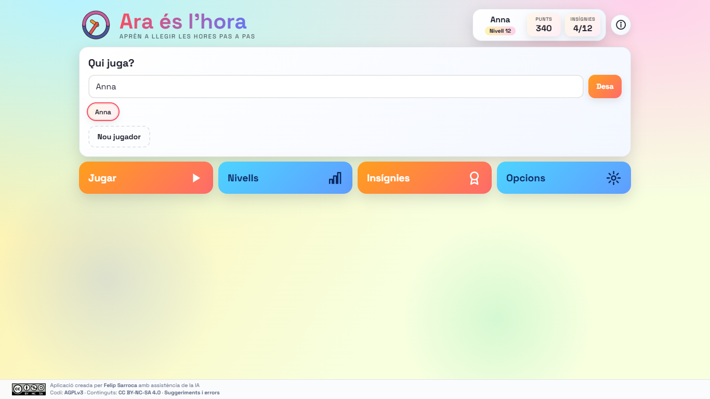
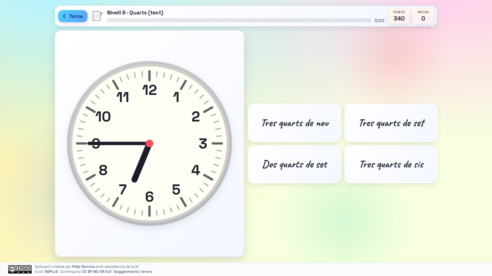
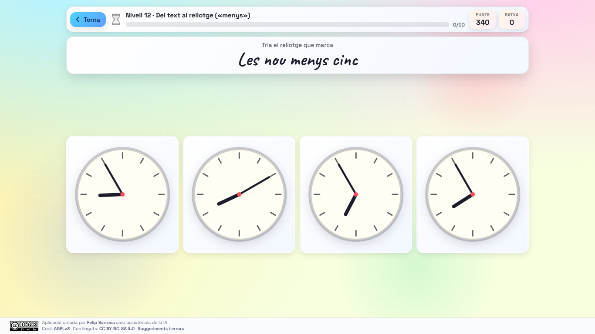
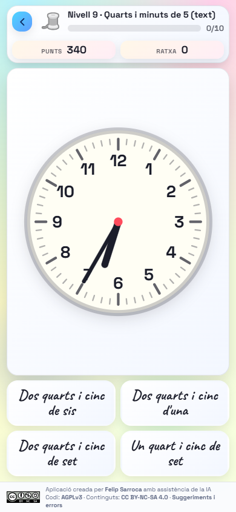

# Ara és l'hora · Aprèn a llegir les hores pas a pas

Joc web per aprendre a llegir el rellotge analògic i a dir l'hora en català amb el sistema tradicional de quarts. Té 12 nivells progressius, insígnies i un perfil per jugador. No cal instal·lar res ni crear cap compte.

- Aplicació: <https://ja.cat/araeslhora>
- Adreça completa: <https://felipsarroca.github.io/edu-apps/LesHores/>

## Com es juga

1. Escriu el teu nom i prem **Desa**. El progrés es desa amb aquest nom al navegador.
2. Prem **Jugar** per anar a l'últim nivell desbloquejat, o tria'n un a **Nivells**.
3. Mira el rellotge (o llegeix la frase) i tria una de les quatre respostes. Si t'equivoques, pots tornar-ho a provar.
4. Per superar un nivell calen **10 encerts** i, en algun moment, **5 encerts seguits**. Cada nivell superat dona una insígnia i obre el següent.

## Nivells

| Nivell | Què es practica | Resposta |
|---|---|---|
| 1 | En punt | Hora digital |
| 2 | En punt i dos quarts | Hora digital |
| 3 | Quarts | Hora digital |
| 4 | Minuts de 5 | Hora digital |
| 5 | Minuts de 5, rellotge sense números | Hora digital |
| 6 | Minuts de 5, rellotge sense marques | Hora digital |
| 7 | En punt i dos quarts | Frase en català |
| 8 | Quarts | Frase en català |
| 9 | Quarts i minuts de 5 («un quart i cinc de…») | Frase en català |
| 10 | Forma «menys» («dos quarts menys cinc de…») | Frase en català |
| 11 | Del text al rellotge (quarts i minuts de 5) | Rellotge |
| 12 | Del text al rellotge (forma «menys», sense números) | Rellotge |

### Criteris de les preguntes

- Totes les hores són de rellotge (de l'1 a les 12) i en format de 12 hores: el que es veu igual a l'analògic és la mateixa pregunta.
- Cada nivell fa servir les 12 hores. No es repeteix cap rellotge fins que s'han vist tots els del nivell, i la mateixa hora no surt en preguntes seguides.
- Els distractors són versemblants: l'hora del costat (error típic amb els quarts), minuts propers, agulles intercanviades i alguna opció més allunyada.
- Les frases segueixen el sistema tradicional de quarts: «la una en punt» (sense apostrofar), «dos quarts d'una», «tres quarts i deu de dues», «les tres menys cinc».

## Pantalles

La interfície s'adapta sola a l'ordinador (1366 × 768, 1920 × 1080), la tauleta i el mòbil, sense desplaçament durant el joc. En pantalla vertical el rellotge queda a dalt i les quatre respostes en una graella de 2 × 2. Hi ha tema clar i fosc, i el so es pot desactivar a **Opcions**.

## Fitxers

| Fitxer | Funció |
|---|---|
| `index.html` | Estructura de les pantalles |
| `styles.css` | Disseny fluid, temes clar i fosc |
| `app.js` | Perfils, pantalles, partida, insígnies i so |
| `engine.js` | Tria de preguntes sense repeticions i distractors |
| `levels.json` | Definició dels 12 nivells (minuts, mode, objectiu i punts) |
| `time_bank.json` | Les 144 hores amb el text en quarts i en forma «menys» |
| `badges.json` | Insígnies de cada nivell |
| `scripts/genera_banc.py` | Regenera `time_bank.json` |

Per provar-la en local cal un servidor (per exemple, `python -m http.server` dins de la carpeta) i obrir `http://localhost:8000`.

## Autoria i llicència

Aplicació creada per **[Felip Sarroca](https://ja.cat/felipsarroca)** amb assistència de la IA.

- **Codi:** [GNU AGPLv3 o posterior](LICENSE).
- **Continguts:** [Creative Commons BY-NC-SA 4.0](https://creativecommons.org/licenses/by-nc-sa/4.0/deed.ca).
- **Suggeriments i errors:** [formulari d'incidències de GitHub](https://github.com/felipsarroca/edu-apps/issues/new?template=leshores.yml).
