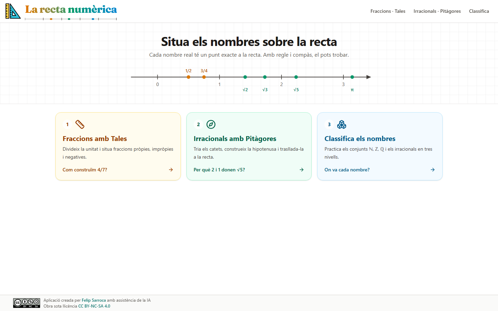
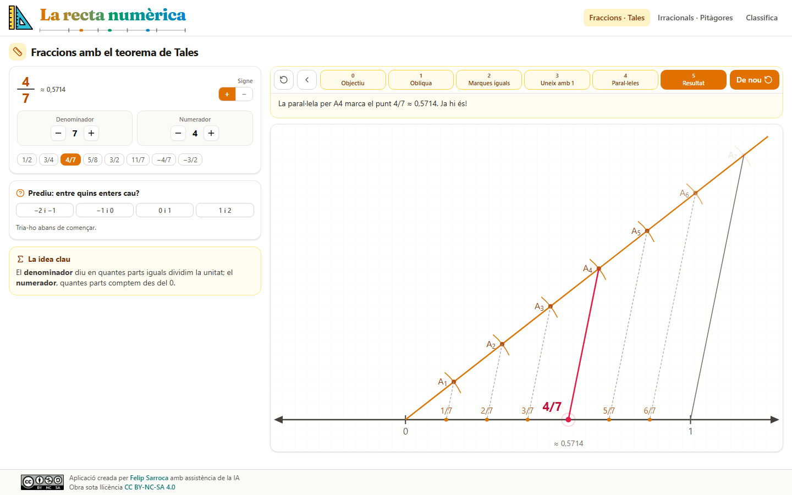
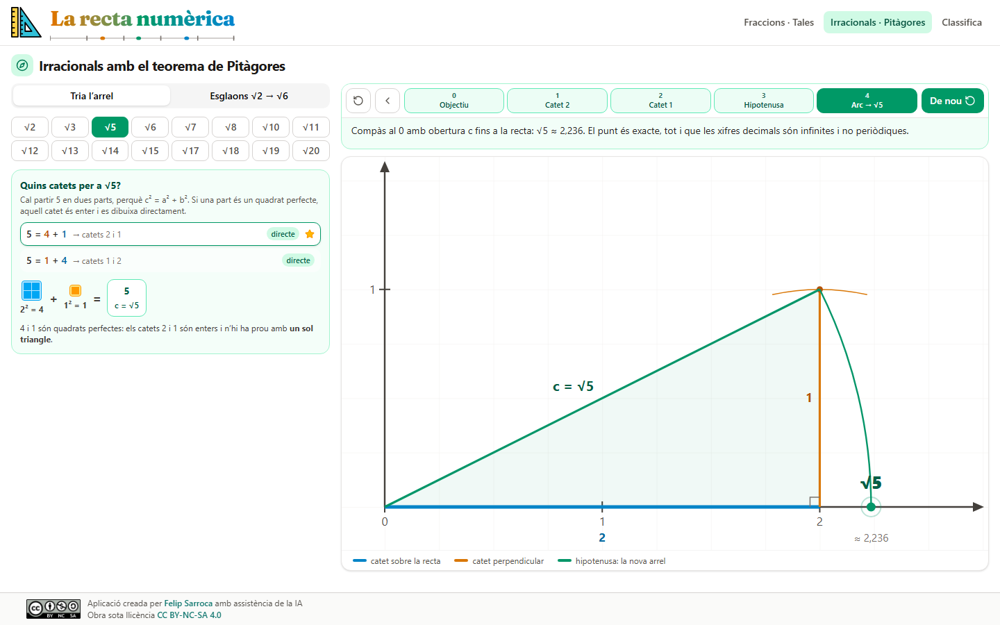
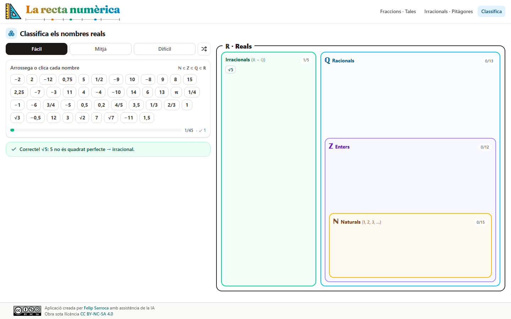

# La recta numèrica

Aplicació interactiva de matemàtiques per **situar nombres reals sobre la recta** i entendre les construccions geomètriques que hi ha darrere de fraccions i arrels quadrades. Està pensada per treballar aquests continguts a l’ESO, a classe o de manera autònoma.

**[Obre l’aplicació](https://felipsarroca.github.io/edu-apps/NombresReals/)** · [Enllaç curt](https://ja.cat/nombres)

## Activitats

| Activitat | Què permet fer |
| --- | --- |
| [Fraccions amb Tales](https://felipsarroca.github.io/edu-apps/NombresReals/fraccions/) | Triar una fracció positiva o negativa, predir entre quins enters cau i construir-la pas a pas dividint la unitat amb el teorema de Tales. Inclou fraccions pròpies i impròpies. |
| [Irracionals amb Pitàgores](https://felipsarroca.github.io/edu-apps/NombresReals/irracionals/) | Escollir una arrel quadrada, estudiar els catets d’un triangle rectangle i traslladar la longitud de la hipotenusa a la recta. També inclou una construcció per esglaons de √2 a √6. |
| [Classifica els nombres](https://felipsarroca.github.io/edu-apps/NombresReals/classifica/) | Situar nombres al conjunt més específic entre naturals, enters, racionals i irracionals. Hi ha tres nivells, pistes després dels errors i un indicador de progrés. Es pot arrossegar cada nombre o seleccionar-lo amb un clic i clicar el conjunt. |

La classificació fa servir la convenció **ℕ = {1, 2, 3, …}**. Les activitats s’executen al navegador, sense registre ni base de dades; el progrés es reinicia en recarregar la pàgina.

### Proposta d’ús a l’aula

1. Predir la posició d’una fracció i justificar-la abans de veure’n la construcció.
2. Comparar la divisió de la unitat amb Tales i la construcció d’una arrel amb Pitàgores.
3. Acabar classificant exemples dels conjunts imbricats ℕ ⊂ ℤ ⊂ ℚ i dels irracionals.

## Captures de pantalla

Les captures mostren l’aplicació en ordinador. Les dues construccions s’han avançat fins al resultat perquè se’n pugui veure el traçat complet.

### Portada



### Construcció de 4/7 amb Tales



### Construcció de √5 amb Pitàgores



### Classificació dels nombres reals



## Executar en local

Cal tenir [Bun](https://bun.com/) instal·lat. Des de `NombresReals/`:

```powershell
bun install --frozen-lockfile
bun run dev
```

Obre <http://localhost:3000>. Les rutes locals són `/`, `/fraccions/`, `/irracionals/` i `/classifica/`.

Per generar i servir l’exportació estàtica en local:

```powershell
bun run build
bun run start
```

El resultat es desa a `out/`. L’ordre `start` mostra al terminal l’adreça on es pot consultar. Si `bun install` falla en una unitat de Google Drive, treballa en una còpia del projecte en un disc local.

## Publicar a GitHub Pages

Aquest repositori publica el contingut de la branca `main` directament. L’exportació de Next.js s’ha de copiar a l’arrel de `NombresReals/`, juntament amb el codi font, abans de pujar els canvis:

```powershell
$env:NEXT_PUBLIC_BASE_PATH = '/edu-apps/NombresReals'
bun run build
Copy-Item -Path .\out\* -Destination . -Recurse -Force
Remove-Item Env:NEXT_PUBLIC_BASE_PATH
```

La variable `NEXT_PUBLIC_BASE_PATH` adapta les rutes dels recursos a l’adreça de GitHub Pages. El fitxer `.nojekyll` de l’arrel del repositori permet publicar la carpeta `_next/`. L’ordre `build` executa `scripts/fix-export.mjs` per ajustar els noms d’alguns fitxers de precàrrega de Next.js 16. Per a una compilació local posterior, assegura’t que `NEXT_PUBLIC_BASE_PATH` no estigui definida.

## Estructura i tecnologies

| Element | Funció |
| --- | --- |
| `src/app/` | Portada i pàgines de les tres activitats. |
| `src/components/math/` | Construccions SVG, seqüències de passos i exercici de classificació. |
| `public/` | Recursos gràfics de l’aplicació. |
| `docs/captures/` | Captures utilitzades en aquest README. |
| `scripts/` | Servidor local de l’exportació i ajust dels fitxers exportats. |

L’aplicació està feta amb **Next.js 16**, **React 19**, **TypeScript**, **Tailwind CSS** i gràfics **SVG**. La configuració `output: 'export'` permet servir-la com a web estàtica.

## Autoria i llicència

Aplicació creada per [Felip Sarroca](https://ja.cat/felipsarroca) amb assistència de la IA. Publicada sota la llicència [Creative Commons Reconeixement-NoComercial-CompartirIgual 4.0 Internacional (CC BY-NC-SA 4.0)](https://creativecommons.org/licenses/by-nc-sa/4.0/deed.ca).
