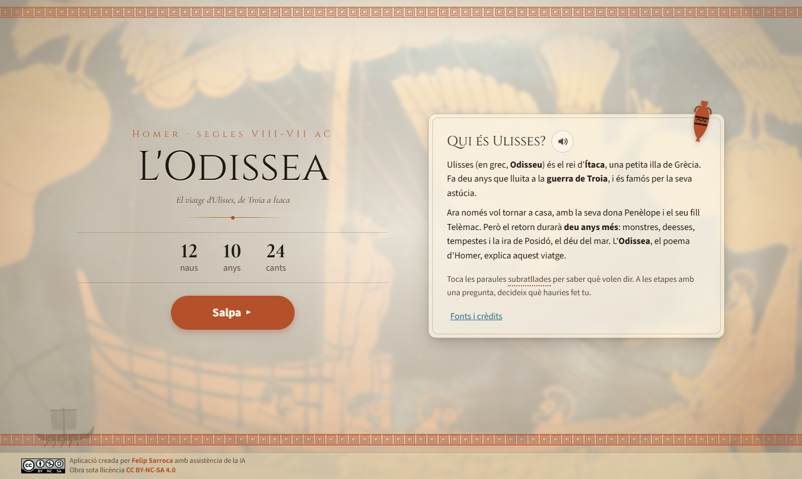
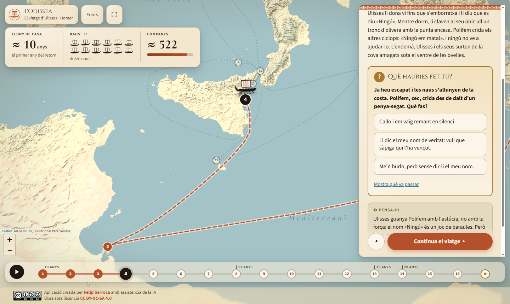
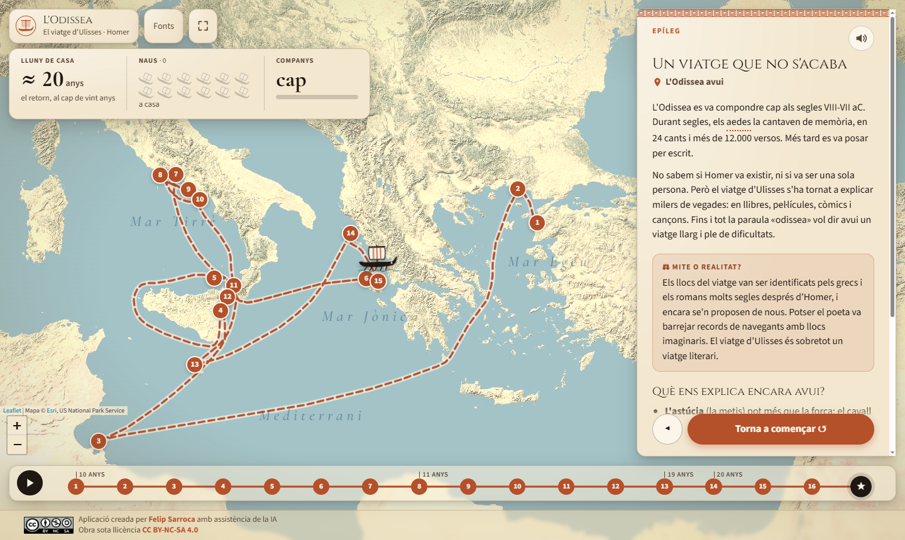
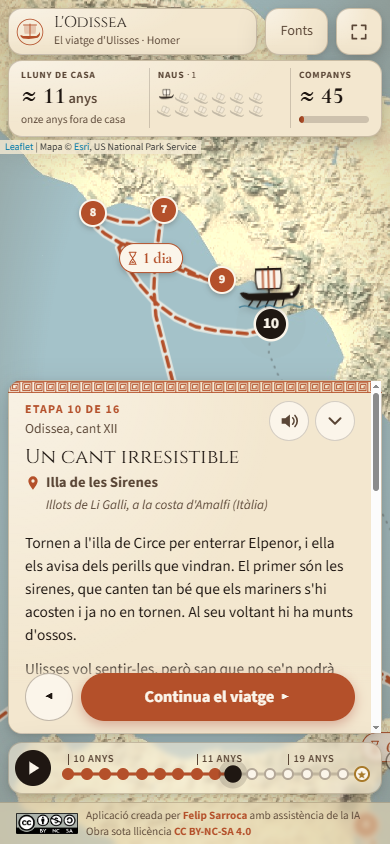

<div align="center">

# 🏺 L'Odissea

Mapa animat en català per reviure el viatge d'Ulisses de Troia a Ítaca, tal com l'explica Homer, etapa per etapa


**[▶ Obre l'aplicació: ja.cat/ulisses](https://ja.cat/ulisses)**



</div>

---

## Què és

Un mapa de la Mediterrània on una nau grega segueix el retorn d'Ulisses, des de Troia fins a Ítaca. L'alumnat avança amb un sol botó i, a cada etapa, veu què li passa a la flota:

- 🏠 **Lluny de casa**: el comptador d'anys va dels deu de la guerra als vint del retorn.
- ⛵ **Naus**: les dotze naus es perden una a una, fins que Ulisses arriba sol a Ítaca.
- 👥 **Companys**: la barra baixa d'uns 600 homes a cap. Cada etapa explica quants se'n perden i per què.
- ⏳ **Dies de navegació**: quan el poema els dona (els nou dies de tempesta, els deu de deriva…), apareixen sobre la ruta.

Funciona en ordinador, tauleta, mòbil i pissarra digital. La interfície s'escala segons l'amplada i l'alçada de la pantalla: es veu proporcionada tant en un portàtil de 1366x740 com en una pantalla de 1920x1080.



## La idea pedagògica

| Element | Per a què serveix |
|---|---|
| **Viatge animat** | Situa al mapa uns llocs que l'alumnat sovint només coneix de nom, i fa visible com s'allarga el retorn. |
| **«Què hauries fet tu?»** | Cinc moments de decisió: el ciclop, les sirenes, Escil·la, les vaques del Sol i l'oferta de Calipso. L'alumne tria i després descobreix què passa al poema. La reproducció automàtica s'hi atura per debatre a classe. |
| **El text d'Homer** | Cites breus del poema, en traducció pròpia i adaptada, amb el cant i els versos. |
| **Mite o realitat?** | Caixes que separen el que diu el poema del que són identificacions o hipòtesis posteriors. |
| **Pensa-hi** | Preguntes sobre valors que el poema posa en joc: l'astúcia, l'hospitalitat (*xenia*), l'orgull (*hybris*), la fidelitat… |
| **Glossari** | Les paraules subratllades (*nostos*, *xenia*, ciclop, aede…) es poden consultar amb un toc. |
| **Narració en català** | Botó 🔊 a la portada i a cada etapa, amb veu neuronal catalana (Joana) en àudios pregenerats: sona igual a tots els navegadors. |

Encaixa amb el currículum de l'ESO (Decret 175/2022): la Cultura clàssica i la Llengua i literatura (lectura de clàssics, mitologia, pervivència del món grec) i les Ciències Socials (el món grec antic i la Mediterrània).



## Com fer-la servir a l'aula

- **Amb tot el grup (pissarra digital).** Premeu ▶ per reproduir el viatge sol. A cada decisió s'atura: voteu, debateu i continueu.
- **Individualment o per parelles.** Cada alumne avança al seu ritme amb «Continua el viatge». Les fletxes ← → del teclat també funcionen.
- **Enllaç a una etapa concreta.** Cada etapa té el seu enllaç (per exemple, `ja.cat/ulisses#ciclop`). Va bé per a Google Classroom.
- **Per acabar.** L'epíleg explica com ha arribat l'Odissea fins avui i per què «odissea» vol dir encara un viatge llarg i difícil.

<p align="center"></p>

## Estructura del codi

Web estàtica, sense compilació ni dependències instal·lades. Fa servir [Leaflet](https://leafletjs.com) per al mapa.

```
Odissea/
├── index.html
├── css/styles.css
├── js/
│   ├── main.js           Estat, navegació, reproducció automàtica i teclat
│   ├── mapa.js           Mapa, ruta i animació de la nau
│   ├── marcador.js       Comptadors d'anys, naus i companys
│   ├── targeta.js        Text de l'etapa, decisions, glossari i lectura en veu alta
│   ├── cronologia.js     Barra d'etapes inferior
│   ├── veu.js            Reproductor de la narració
│   ├── util.js           Geometria i utilitats
│   └── dades/
│       ├── etapes.js     ← Tot el contingut: 16 etapes i l'epíleg
│       ├── glossari.js
│       └── fonts.js
├── audio/                Narració en MP3 (una per etapa i una per desenllaç de decisió)
├── eines/genera-audios.mjs
├── img/                  Imatge de fons de la portada
└── assets/
```

**Per corregir o ampliar el contingut només cal editar `js/dades/etapes.js`.**

**Si canvies algun text, regenera'n l'àudio.** Cal Node i `edge-tts` (`pip install edge-tts`):

```bash
node eines/genera-audios.mjs ciclop    # només una etapa
node eines/genera-audios.mjs --tots    # totes
```

Per provar-la en local cal un servidor (els mòduls JS no funcionen amb `file://`):

```bash
python -m http.server
```

## Rigor

- **La geografia de l'Odissea és poètica.** Els llocs del mapa són les identificacions tradicionals (Tucídides, Estrabó i la tradició posterior), no fets demostrats.
- **Les rutes són orientatives.** Homer no descriu el camí entre els llocs; els dies de navegació sí que surten al poema.
- **Els ≈ 600 companys inicials són una estimació** (unes 50 persones per nau). Les pèrdues sí que segueixen el poema: sis per nau a Ísmar, sis amb el ciclop, onze naus amb els lestrígons…
- **Les cites són traduccions pròpies del grec**, adaptades per facilitar-ne la lectura. Per llegir el poema sencer en català, la referència és la traducció de Carles Riba.
- La llista completa de fonts és a l'app, al botó **Fonts**.

## Autoria i llicència

Aplicació creada per [Felip Sarroca](https://ja.cat/felipsarroca) amb assistència de la IA. Obra sota llicència [CC BY-NC-SA 4.0](https://creativecommons.org/licenses/by-nc-sa/4.0/deed.ca).

Idea original: l'app «Els viatges d'Ulisses», adaptació catalana d'una proposta de Ramón Besonías. El contingut d'aquesta versió s'ha escrit de nou.

Imatge de la portada: *Ulisses i les sirenes*, estàmnos àtic del Pintor de les Sirenes (c. 480-470 aC), British Museum (E440), domini públic. Mapa base: © Esri, US National Park Service.
