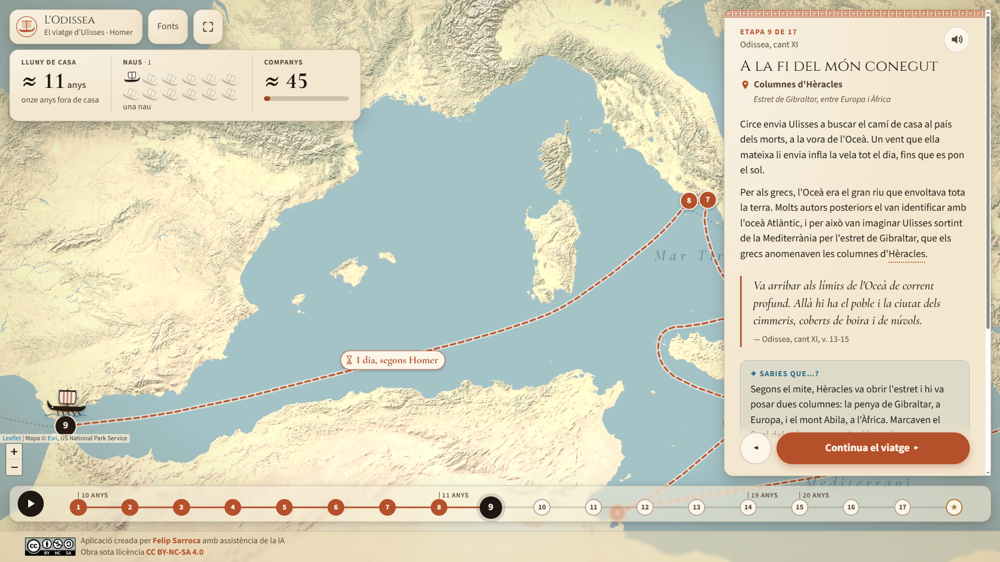
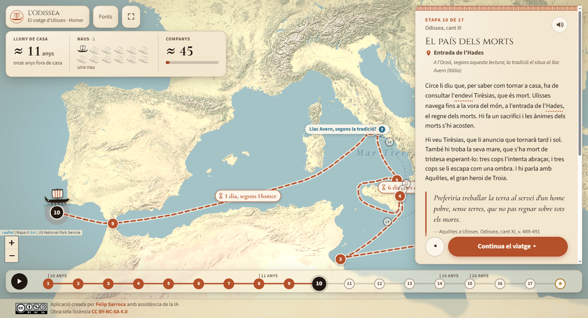
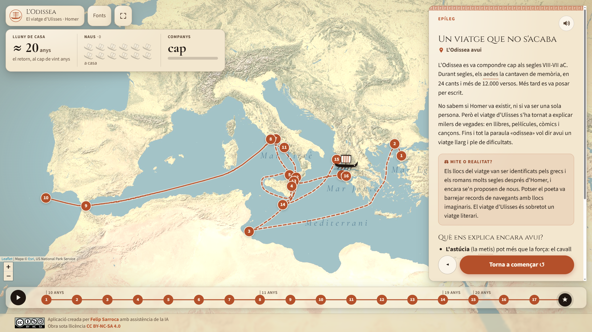
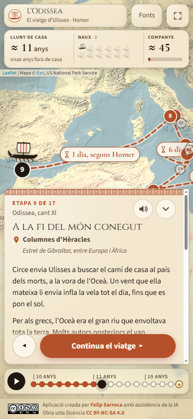

<div align="center">


# L'Odissea d'Homer

Mapa animat en català per reviure el viatge d'Ulisses de Troia a Ítaca, tal com l'explica Homer, etapa per etapa


**[▶ Obre l'aplicació: ja.cat/ulisses](https://ja.cat/ulisses)**

<sub>Enllaç directe: <a href="https://felipsarroca.github.io/edu-apps/Odissea/">felipsarroca.github.io/edu-apps/Odissea</a></sub>


</div>

---

## Índex

- [Què és](#què-és)
- [El viatge en 17 etapes](#el-viatge-en-17-etapes)
- [La idea pedagògica](#la-idea-pedagògica)
- [Com fer-la servir a l'aula](#com-fer-la-servir-a-laula)
- [Rigor: mite, tradició i hipòtesi](#rigor-mite-tradició-i-hipòtesi)
- [Estructura del codi](#estructura-del-codi)
- [Autoria i llicència](#autoria-i-llicència)

## Què és

Un mapa de la Mediterrània on una nau grega segueix el retorn d'Ulisses, des de Troia fins a Ítaca. L'alumnat avança amb un sol botó i, a cada etapa, veu què li passa a la flota:

| Comptador | Què mostra |
|---|---|
| 🏠 **Lluny de casa** | Els anys passen dels deu de la guerra als vint del retorn. |
| ⛵ **Naus** | Les dotze naus es perden una a una, fins que Ulisses arriba sol a Ítaca. |
| 👥 **Companys** | La barra baixa d'uns 600 homes a cap. Cada etapa explica quants se'n perden i per què. |
| ⏳ **Dies de navegació** | Quan el poema els dona (els nou dies de tempesta, el dia de vent fins a l'Oceà…), apareixen sobre la ruta. |

Funciona en ordinador, tauleta, mòbil i pissarra digital. La interfície s'escala segons l'amplada i l'alçada de la pantalla i s'ha comprovat en un portàtil de 1366x740, en una pantalla de 1920x1080 i en mòbil.


## El viatge en 17 etapes

| # | Etapa | Lloc | Cant | Decisió |
|---|---|---|---|---|
| 1 | La guerra ha acabat | Troia | IX | |
| 2 | Massa cobdícia | Ísmar, terra dels cícons | IX | |
| 3 | La flor de l'oblit | País dels lotòfags | IX | |
| 4 | Em dic Ningú | Illa dels ciclops | IX | ❓ |
| 5 | Un sac ple de vents | Illa d'Èol | X | |
| 6 | Tan a prop de casa | Davant de les costes d'Ítaca | X | |
| 7 | Gegants caníbals | Lamos, país dels lestrígons | X | |
| 8 | Homes convertits en porcs | Eea, illa de Circe | X | |
| 9 | A la fi del món conegut | Columnes d'Hèracles | XI | |
| 10 | El país dels morts | Entrada de l'Hades | XI | |
| 11 | Un cant irresistible | Illa de les Sirenes | XII | ❓ |
| 12 | Entre dos monstres | Escil·la i Caribdis | XII | ❓ |
| 13 | Les vaques del Sol | Trinàcia, illa d'Hèlios | XII | ❓ |
| 14 | Set anys i una pregunta | Ogígia, illa de Calipso | V | ❓ |
| 15 | Nàufrag i convidat | Esquèria, país dels feacis | VI-VIII | |
| 16 | Un captaire a casa seva | Ítaca | XIII-XVII | |
| 17 | L'arc i el llit d'olivera | El palau d'Ítaca | XXI-XXIV | |
| ★ | Un viatge que no s'acaba | L'Odissea avui (epíleg) | | |

L'ordre és el del viatge, no el del poema. Homer comença *in medias res*: Ulisses explica les aventures de les etapes 1-13 als feacis (cants IX-XII), després d'haver-se escapat d'Ogígia (cant V).



## La idea pedagògica

| Element | Per a què serveix |
|---|---|
| **Viatge animat** | Situa al mapa uns llocs que l'alumnat sovint només coneix de nom, i fa visible com s'allarga el retorn. |
| **«Què hauries fet tu?»** | Cinc moments de decisió: el ciclop, les sirenes, Escil·la, les vaques del Sol i l'oferta de Calipso. L'alumne tria i després descobreix què passa al poema. La reproducció automàtica s'hi atura per debatre a classe. |
| **El text d'Homer** | Cites breus del poema, en traducció pròpia i adaptada, amb el cant i els versos. |
| **Mite o realitat?** | Caixes que separen el que diu el poema del que són identificacions o hipòtesis posteriors. |
| **Rutes alternatives** | Quan hi ha dues localitzacions defensades, la segona surt al mapa com una línia de punts blava amb un interrogant. |
| **Sabies que…?** | Curiositats que connecten el mite amb el present, com les columnes d'Hèracles de l'escut d'Espanya. |
| **Pensa-hi** | Preguntes sobre valors que el poema posa en joc: l'astúcia, l'hospitalitat (*xenia*), l'orgull (*hybris*), la fidelitat… |
| **Glossari** | Les paraules subratllades (*nostos*, *xenia*, ciclop, aede, Hèracles…) es poden consultar amb un toc. |
| **Narració en català** | Botó 🔊 a la portada i a cada etapa, amb veu neuronal catalana (Joana) en àudios pregenerats: sona igual a tots els navegadors. |

**Encaix curricular** (Decret 175/2022, ESO):

- **Cultura clàssica i Llengua i literatura:** lectura de clàssics, mitologia i pervivència del món grec.
- **Ciències socials:** el món grec antic, la Mediterrània i la lectura de mapes.
- **Educació en valors:** debat a partir de les decisions i de les preguntes «Pensa-hi».



## Com fer-la servir a l'aula

1. **Presentació.** La portada explica qui és Ulisses. Es pot escoltar amb el botó 🔊 abans de salpar.
2. **Amb tot el grup (pissarra digital).** Premeu ▶ per reproduir el viatge sol. A cada decisió s'atura: voteu, debateu i continueu.
3. **Individualment o per parelles.** Cada alumne avança al seu ritme amb «Continua el viatge». Les fletxes ← → del teclat també funcionen, i la barra inferior permet saltar a qualsevol etapa.
4. **Enllaç a una etapa concreta.** Cada etapa té el seu enllaç, per exemple `ja.cat/ulisses#ciclop` o `ja.cat/ulisses#columnes`. Va bé per a Google Classroom.
5. **Per acabar.** L'epíleg mostra el viatge sencer i explica com ha arribat l'Odissea fins avui i per què «odissea» vol dir encara un viatge llarg i difícil.

**Idees d'activitat:**

- Comparar el nombre de companys a l'inici i al final i buscar a l'app la causa de cada pèrdua.
- Debatre per grups una de les cinc decisions abans de veure què va passar.
- Discutir, a partir de les caixes «Mite o realitat?», per què hi ha llocs amb més d'una localització.



<p align="center"></p>

## Rigor: mite, tradició i hipòtesi

- **La geografia de l'Odissea és poètica.** Els llocs del mapa són les identificacions tradicionals (Tucídides, Estrabó i la tradició posterior), no fets demostrats. Cada etapa indica d'on surt la localització.
- **Gibraltar i l'Oceà.** Homer no esmenta mai les columnes d'Hèracles: diu que Ulisses navega fins als límits de l'Oceà. L'app segueix la lectura, defensada ja a l'antiguitat per Crates de Mallos, que identifica l'Oceà amb l'Atlàntic. Per això la nau surt per l'estret (etapa 9) i hi torna abans de les sirenes. També avisa que el poema parla d'un sol dia de navegació per a més de 1.500 km.
- **Les alternatives.** L'entrada de l'Hades té com a alternativa el llac Avern (Itàlia), la localització tradicional. Ogígia té com a alternativa l'Atlàntic, a prop de l'Atles, perquè Calipso és filla d'Atles. Totes dues surten al mapa com una línia de punts blava.
- **Les rutes són orientatives.** Homer no descriu el camí entre els llocs; els dies de navegació sí que surten al poema.
- **Els ≈ 600 companys inicials són una estimació** (unes 50 persones per nau). Les pèrdues sí que segueixen el poema: sis per nau a Ísmar, sis amb el ciclop, onze naus amb els lestrígons…
- **Les cites són traduccions pròpies del grec**, adaptades per facilitar-ne la lectura. Per llegir el poema sencer en català, la referència és la traducció de Carles Riba.
- La llista completa de fonts és a l'app, al botó **Fonts**.

## Estructura del codi

Web estàtica, sense compilació ni dependències instal·lades. Fa servir [Leaflet](https://leafletjs.com) per al mapa.

```
Odissea/
├── index.html
├── favicon.svg
├── css/styles.css
├── js/
│   ├── main.js           Estat, navegació, reproducció automàtica i teclat
│   ├── mapa.js           Mapa, ruta, rutes alternatives i animació de la nau
│   ├── marcador.js       Comptadors d'anys, naus i companys
│   ├── targeta.js        Text de l'etapa, decisions, glossari i lectura en veu alta
│   ├── cronologia.js     Barra d'etapes inferior
│   ├── veu.js            Reproductor de la narració
│   ├── util.js           Geometria i utilitats
│   └── dades/
│       ├── etapes.js     ← Tot el contingut: 17 etapes i l'epíleg
│       ├── glossari.js
│       └── fonts.js
├── audio/                Narració en MP3 (portada, etapes i desenllaços de les decisions)
├── eines/genera-audios.mjs
├── img/                  Imatge de fons de la portada
├── assets/               Distintiu de la llicència
└── docs/captures/        Captures d'aquest README
```

### Editar el contingut

Tot el contingut és a `js/dades/etapes.js`. Cada etapa té aquests camps principals:

| Camp | Contingut |
|---|---|
| `lloc`, `on` | Nom del lloc i identificació geogràfica |
| `cant`, `anys`, `naus`, `companys` | Dades dels comptadors |
| `pos`, `ruta` | Coordenades del punt i punts de pas del tram |
| `durada` | Dies de navegació que es mostren sobre la ruta (opcional) |
| `titol`, `text`, `cita` | Text de la targeta i cita d'Homer |
| `caixa` | Una o diverses caixes: `sabies`, `mite` o `pensa` |
| `decisio` | Pregunta, opcions i desenllaç (opcional) |
| `alternativa` | Segona localització, amb la seva ruta i etiqueta (opcional) |

**Si canvies algun text, regenera'n l'àudio.** Cal Node i `edge-tts` (`pip install edge-tts`):

```bash
node eines/genera-audios.mjs ciclop    # només una etapa
node eines/genera-audios.mjs --tots    # totes
```

### Provar-la en local

Cal un servidor, perquè els mòduls JS no funcionen amb `file://`:

```bash
python -m http.server
```

I obrir `http://localhost:8000`.

## Autoria i llicència

Aplicació creada per [Felip Sarroca](https://ja.cat/felipsarroca) amb assistència de la IA. Obra sota llicència [CC BY-NC-SA 4.0](https://creativecommons.org/licenses/by-nc-sa/4.0/deed.ca).

Idea original: l'app «Els viatges d'Ulisses», adaptació catalana d'una proposta de Ramón Besonías. El contingut d'aquesta versió s'ha escrit de nou.

Imatge de la portada: *Ulisses i les sirenes*, estàmnos àtic del Pintor de les Sirenes (c. 480-470 aC), British Museum (E440), domini públic. Mapa base: © Esri, US National Park Service.
