# Laboratori de reactius i sobrants

Aplicació web per entendre el **reactiu limitant**, el **reactiu en excés** i els **sobrants** d'una reacció química. L'alumnat agrupa els reactius en *lots* iguals a la recepta (l'equació igualada) i veu com es transformen en productes. Comença amb analogies (entrepans, bicicletes, polseres), continua amb molècules dibuixades àtom a àtom i acaba amb càlculs de mols i grams de batxillerat.

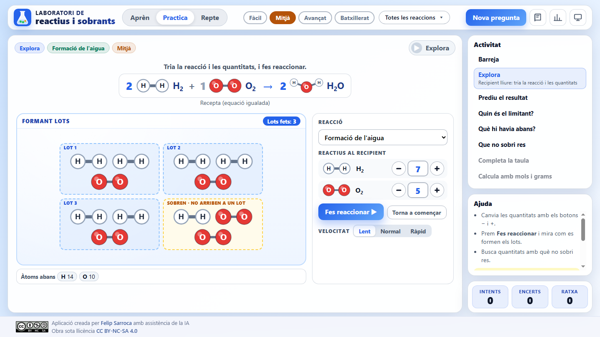

## Índex

- [Què ofereix](#què-ofereix)
- [La idea dels lots](#la-idea-dels-lots)
- [Mode Aprèn](#mode-aprèn)
- [Mode Practica](#mode-practica)
- [Missatges, pistes i errors conceptuals](#missatges-pistes-i-errors-conceptuals)
- [Mode Repte](#mode-repte)
- [Quadern del laboratori](#quadern-del-laboratori)
- [Adaptació a la pantalla](#adaptació-a-la-pantalla)
- [Ús a l'aula](#ús-a-laula)
- [Estructura del projecte](#estructura-del-projecte)
- [Execució local](#execució-local)
- [Afegir o modificar reaccions](#afegir-o-modificar-reaccions)
- [Llicència](#llicència)

## Què ofereix

- **39 reaccions** amb 49 casos clau, més 10 problemes de mols i 2 de rendiment i puresa. Es reparteixen en quatre nivells:

  | Nivell | Curs | Contingut | Reaccions |
  |---|---|---|---|
  | Fàcil | 2n–3r d'ESO | Analogies amb peces: entrepans, bicicletes, cotxes, taules, rams, polseres | 9 |
  | Mitjà | 3r–4t d'ESO | Molècules senzilles: aigua, amoníac, combustions, pluja àcida | 12 |
  | Avançat | 4t d'ESO | Reaccions reals: respiració, fotosíntesi, alt forn, neutralitzacions | 18 |
  | Batxillerat | 1r de batxillerat | Mols, masses molars, rendiment i puresa | 12 problemes |

- **Set famílies** que es poden filtrar: analogies, combustions, atmosfera i contaminació, éssers vius, indústria, àcids i bases, i reaccions d'un sol reactiu.
- **Tres modes**: Aprèn (8 mòduls amb laboratoris interactius), Practica (7 activitats, amb pistes i solució) i Repte (10 preguntes puntuades).
- **Models moleculars**: cada substància es dibuixa amb els seus àtoms. Els compostos iònics (NaCl, MgO, CaCO₃…) porten una vora discontínua: són unitats de fórmula, no molècules.
- **Comptador d'àtoms**: mostra que els àtoms es conserven, també els dels sobrants.
- **«A la vida real»**: cada reacció porta una fitxa sobre on passa (la cuina, el cotxe, el cos, la indústria).
- **Diagnòstic d'errors conceptuals**: l'app reconeix 14 errors típics i en porta el compte.
- **Sense dependències ni registre**: no cal cap compte i tot es desa al navegador.

## La idea dels lots

Un **lot** és un grup de reactius exactament igual a la recepta. Per saber què passarà:

1. Es divideix la quantitat de cada reactiu pel seu coeficient: són els lots que en pots fer.
2. El valor més petit és el nombre de lots que es fan. El reactiu que el dona és el **limitant**.
3. Cada lot dona els productes de la recepta. El que no completa un lot **sobra**.

L'animació del recipient segueix aquests tres passos: *Formant lots* → *Cada lot es transforma* → *Després de la reacció*. El sobrant queda en una caixa groga amb l'etiqueta «No ha reaccionat».

Amb partícules, el limitant pot deixar un lot incomplet (7 H₂ i 5 O₂ fan 3 lots i sobra 1 H₂). L'app ho explica i recorda que, amb quantitats reals com els mols, el limitant s'esgota del tot.

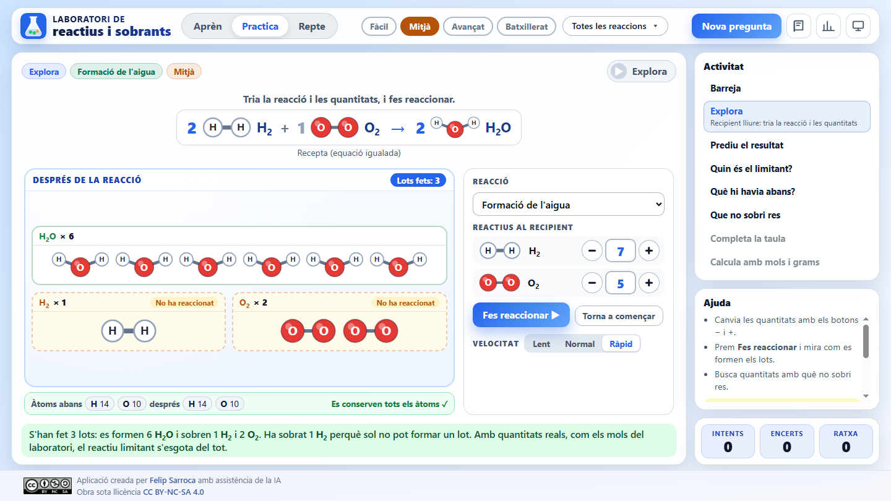

## Mode Aprèn

| Mòdul | Contingut | Laboratori interactiu | Nivell |
|---|---|---|---|
| 0. La recepta d'una reacció | Equació igualada, coeficients i subíndexs | Receptes de l'entrepà i de l'aigua | Fàcil |
| 1. Els lots | Agrupar en lots iguals a la recepta | Entrepans amb quantitats editables | Fàcil |
| 2. Reactiu limitant i en excés | El limitant no és sempre el que en tens menys | 6 H₂ i 5 O₂, editable | Fàcil |
| 3. Què es conserva i què no | Àtoms i massa sí; molècules, no sempre | Comptador d'àtoms | Mitjà |
| 4. La taula Abans / Canvi / Després | Exemple resolt amb N₂ + 3 H₂ | El mateix exemple animat | Avançat |
| 5. Del lot al mol | Passar a mols i dividir pel coeficient | Passos per resoldre un problema | Batxillerat |
| 6. Per què es posa un reactiu en excés? | Cost, seguretat i neutralització | Combustió completa i incompleta (CO) | Avançat |
| 7. La química de cada dia | Galeria de reaccions quotidianes | Botó «Prova-ho al laboratori» | Fàcil |

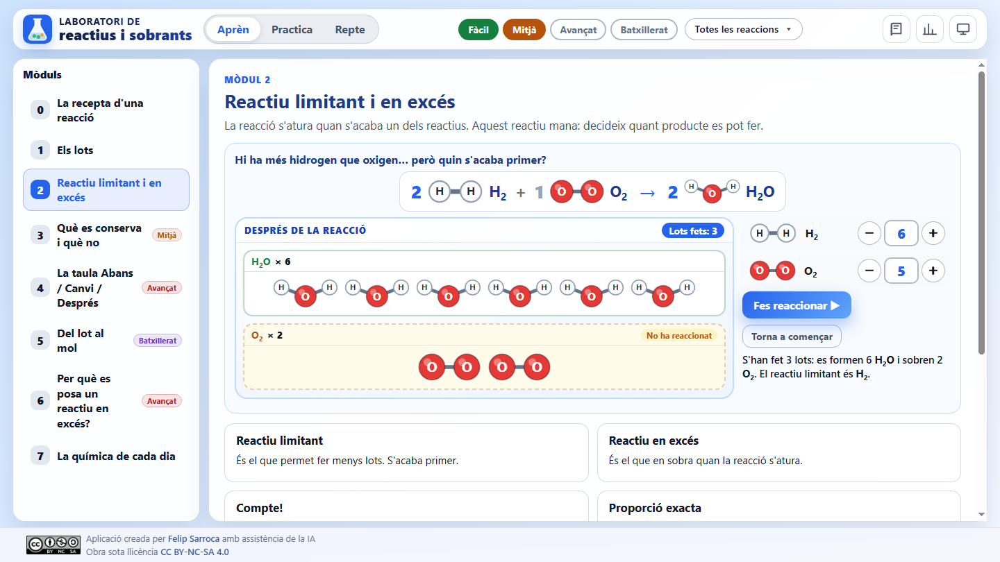

## Mode Practica

| Activitat | Què fa l'alumne | Nivells |
|---|---|---|
| **Explora** | Tria la reacció i les quantitats, i fa reaccionar el recipient a tres velocitats | Fàcil, Mitjà, Avançat |
| **Prediu el resultat** | Diu quants productes es formen i quants reactius sobren | Fàcil, Mitjà, Avançat |
| **Quin és el limitant?** | Tria el reactiu limitant, «proporció exacta» o «només hi ha un reactiu». A Avançat, també ha de triar *per què* | Fàcil, Mitjà, Avançat |
| **Què hi havia abans?** | A partir dels productes i dels sobrants, dedueix els reactius inicials | Mitjà, Avançat |
| **Que no sobri res** | Posa els reactius justos per obtenir una quantitat de producte | Fàcil, Mitjà, Avançat |
| **Completa la taula** | Omple les files Canvi i Després (amb partícules) o la taula en mols (batxillerat) | Avançat, Batxillerat |
| **Calcula amb mols i grams** | Troba el limitant, la massa de producte i la massa que sobra. Inclou problemes de rendiment i puresa | Batxillerat |
| **Barreja** | Alterna totes les activitats disponibles | Tots |

Les quantitats es generen a l'atzar dins dels límits de cada nivell (com a màxim 40 partícules dibuixades) o es trien entre els casos clau, que treballen errors concrets. Quan la resposta és correcta, el recipient anima la reacció.

| Prediu el resultat | Completa la taula |
|---|---|
| 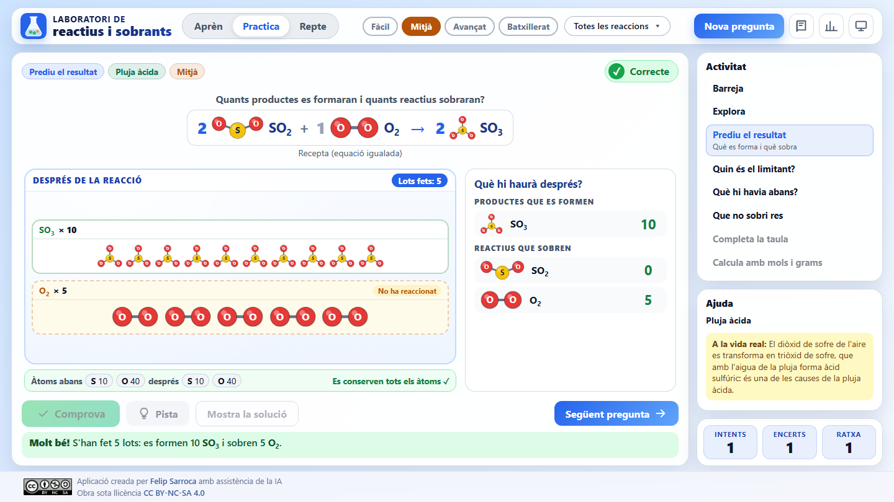 | 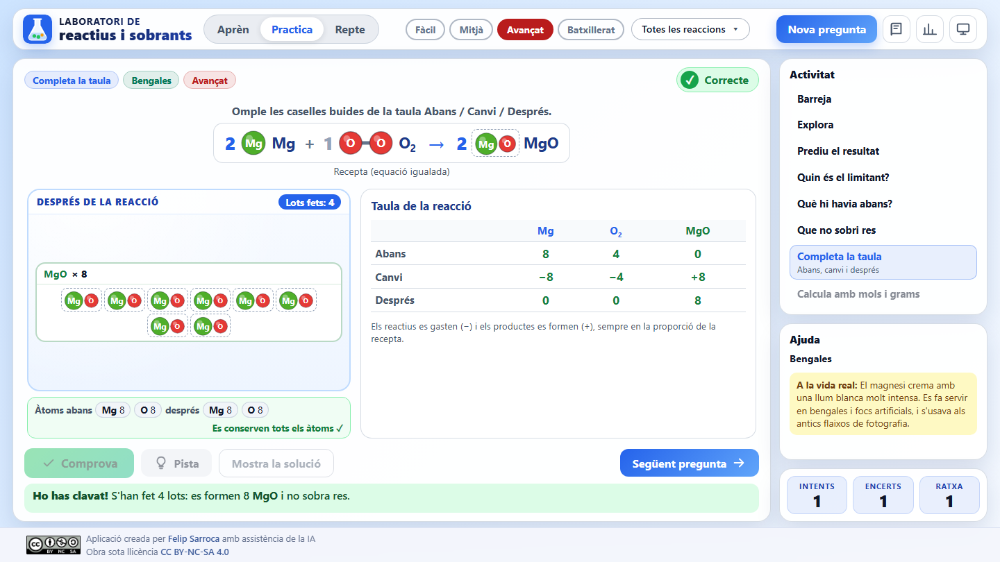 |

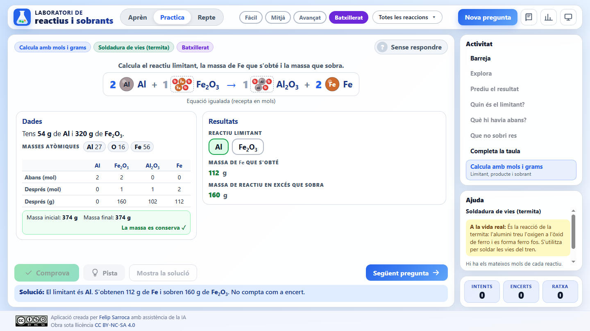

## Missatges, pistes i errors conceptuals

Quan la resposta no és correcta, l'app no dona la solució, sinó que diagnostica l'error:

| Codi | Error conceptual | Exemple de missatge |
|---|---|---|
| E1 | El limitant és el que en tens menys | «No és el que en tens menys. Mira els lots: H₂ → 3 lots i O₂ → 5 lots.» |
| E2 | El limitant es tria només pel coeficient | «Fixa't en les quantitats, no només en el coeficient.» |
| E3 | Comptar només un lot | «Has comptat només 1 lot. Al recipient n'hi caben 4: multiplica pel nombre de lots.» |
| E4 | No veure si sobra o no sobra res | «Aquesta vegada no sobra res: tots els reactius donen per a 3 lots.» |
| E5 | Les molècules es conserven | «Els àtoms es conserven, però les molècules no sempre.» |
| E7 | El sobrant desapareix | «El sobrant no desapareix: queda al recipient sense reaccionar.» |
| E11 | Comparar grams en lloc de mols | «No comparis grams. Passa primer a mols…» |
| E12 | No dividir els mols pel coeficient | «Divideix els mols pel coeficient…» |
| E14 | Els reactius reaccionen 1 a 1 | «Els reactius no sempre reaccionen 1 a 1. La recepta diu…» |
| E15 | Partir molècules per completar un lot | «Una molècula no es pot partir. Si no arriba a un lot sencer, sobra.» |
| E16 | Buscar un limitant amb un sol reactiu | «Aquesta reacció només té un reactiu.» |
| E17 | Formar els productes a parts iguals | «Cada producte es forma segons el seu coeficient…» |

A més:

- **Pistes en tres passos**, de més generals a més concretes, amb els càlculs de l'exercici.
- **Mostra la solució**: ensenya la resposta i anima la reacció, però no compta com a encert i reinicia la ratxa.
- **Ajuda**: el panell lateral recorda l'estratègia de cada activitat i, en acabar, mostra la fitxa «A la vida real».

## Mode Repte

- 10 preguntes de tipus variat amb els filtres actius.
- Dos intents per pregunta, sense pistes ni solució.
- Encertar a la primera val 2 punts; a la segona, 1.
- En acabar es mostren els punts, fins a tres estrelles (90 %, 70 % i 40 %) i una recomanació.

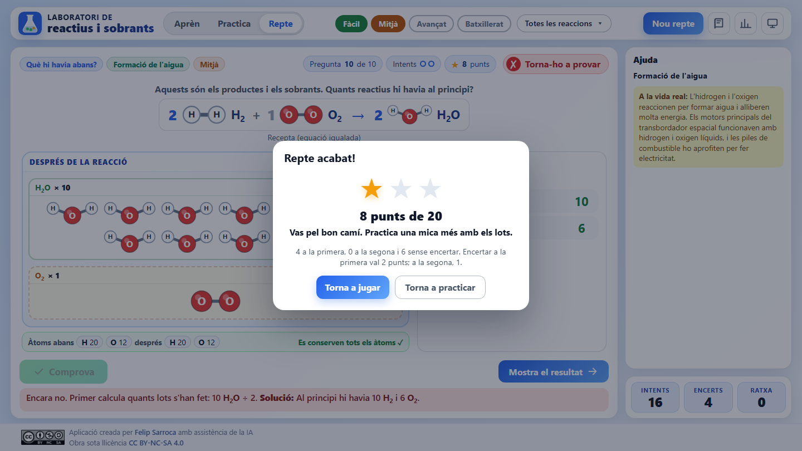

## Quadern del laboratori

Els botons de la barra superior obren el quadern, amb dues pestanyes:

- **Glossari**: 19 termes (lot, reactiu limitant, sobrant, unitat de fórmula, mol, rendiment…) i les masses atòmiques.
- **El meu progrés**: reaccions resoltes, encerts, precisió, millor ratxa, progrés per nivell i **errors que més repeteixes**. Es pot esborrar el progrés.

| Glossari | El meu progrés |
|---|---|
| 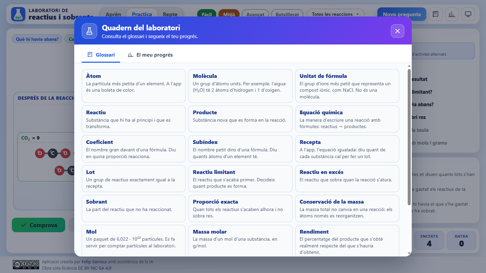 | 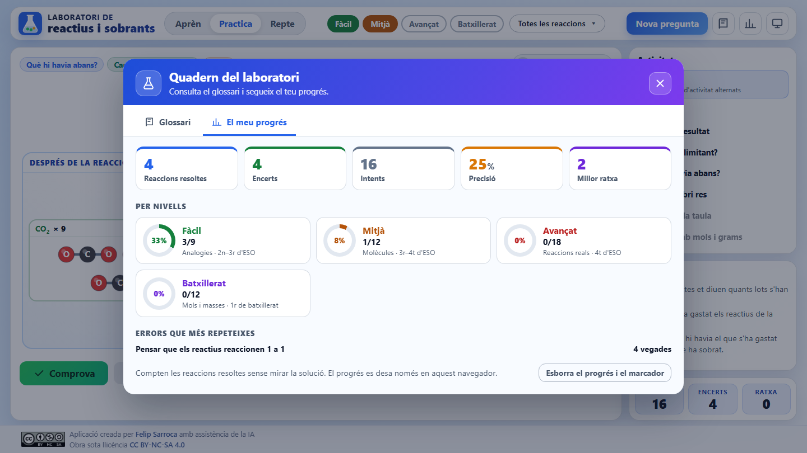 |

## Adaptació a la pantalla

La interfície està pensada per a 1440 × 800 px i s'escala automàticament amb la variable `--ui-zoom` (vegeu `fitScale` a `js/app.js`), com les altres apps d'`edu-apps`. Tota l'activitat cap en una sola pantalla, sense desplaçament, a:

- 1920 × 1080 (s'amplia);
- 1366 × 768 i 1366 × 740 (es redueix);
- escalat del sistema al 125 % i al 150 % (amb alçada útil petita, es compacta la pregunta i el recipient);
- tauleta (1024 × 768).

Les partícules s'ajusten soles: si no caben al recipient, se'n redueix la mida pas a pas.

Hi ha dos casos especials:

- **Mode projector** (botó de la pantalla): fa servir una base més petita perquè tot es vegi més gran a la pissarra digital.
- **Mòbil** (menys de 900 px d'amplada): la disposició passa a una columna amb desplaçament vertical.

| Mode projector | Mòbil |
|---|---|
| 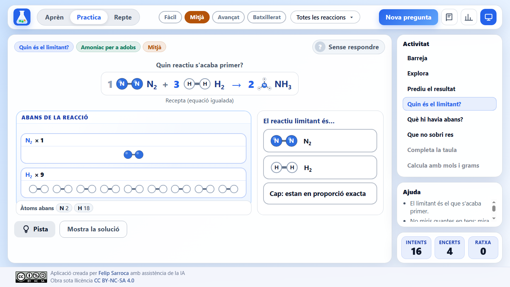 | 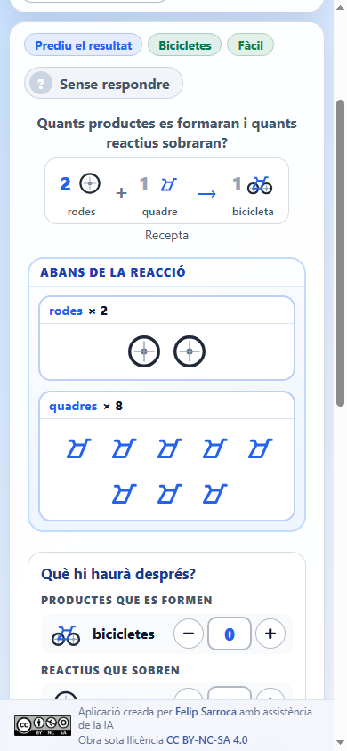 |

## Ús a l'aula

| Moment | Proposta |
|---|---|
| **Introducció** | Amb el mode projector, treballeu els mòduls 0 i 1 amb els entrepans: «Amb 7 llesques de pa i 3 de formatge, quants entrepans fem?» |
| **Conflicte cognitiu** | Al mòdul 2, demaneu una predicció abans de prémer *Fes reaccionar*: amb 6 H₂ i 5 O₂, la majoria dirà que s'acaba l'oxigen. |
| **Pràctica guiada** | En parelles, «Prediu el resultat» i «Quin és el limitant?» al nivell del grup. Un membre prediu i l'altre comprova amb Explora. |
| **Autonomia** | Activeu «Barreja». Les pistes ajuden sense donar la resposta. |
| **Avaluació formativa** | Cada alumne fa un Repte i lliura una captura del resultat a Google Classroom. «Errors que més repeteixes» indica què cal reforçar. |
| **Atenció a la diversitat** | El nivell Fàcil no necessita fórmules i les activitats amb botons no demanen escriure: és accessible per a l'alumnat nouvingut o amb NESE. El nivell Batxillerat permet ampliar. |

Connexió curricular (LOMLOE, currículum de Catalunya): Física i Química d'ESO, *el canvi químic*: interpretació de les equacions químiques, conservació de la massa (llei de Lavoisier) i càlculs estequiomètrics senzills; i Física i Química de 1r de batxillerat: estequiometria amb reactiu limitant, rendiment i puresa.

## Estructura del projecte

```text
ReactiusSobrants/
├── index.html                    # Estructura de la pàgina i diàlegs
├── Disseny.md                    # Disseny didàctic: reaccions, errors i textos
├── css/styles.css                # Estils i adaptació a la pantalla
├── js/
│   ├── reaccions.js              # Nivells, famílies, peces, reaccions, casos i problemes
│   ├── motor.js                  # Lots, generació de casos, diagnòstic, pistes i càlculs amb mols
│   ├── reactor.js                # Recipient, partícules, receptes i animació dels lots
│   ├── molecules.js              # Models moleculars en SVG (compartit amb IgualacioQuimica)
│   ├── chem.js                   # Lectura de fórmules (compartit amb IgualacioQuimica)
│   ├── icons.js                  # Icones de les peces de les analogies
│   ├── aprenentatge.js           # Contingut dels mòduls del mode Aprèn
│   └── app.js                    # Interfície, activitats, repte i progrés
├── scripts/valida-reaccions.mjs  # Validació automàtica de les dades
├── docs/                         # Captures del README
├── assets/CC_BY-NC-SA.png        # Distintiu de la llicència
└── favicon.svg
```

No depèn de cap biblioteca externa i funciona sense connexió un cop carregada.

El progrés es desa al `localStorage` del navegador amb tres claus:

| Clau | Contingut |
|---|---|
| `rs_settings_v1` | Nivells, famílies, activitat, velocitat, mode projector, darrer mòdul i darrera pestanya del quadern |
| `rs_stats_v1` | Intents, encerts, ratxa actual, millor ratxa i recompte d'errors conceptuals |
| `rs_progress_v1` | Reaccions i problemes resolts (per identificador) |

## Execució local

Cal un servidor web estàtic, perquè el navegador no carrega mòduls JavaScript des de `file://`. Des de la carpeta de l'app:

```bash
python -m http.server 8000
```

Després obriu `http://localhost:8000`.

## Afegir o modificar reaccions

Les reaccions són a `REACTIONS`, a `js/reaccions.js`. Per exemple:

```js
{ id: "M2", level: 2, families: ["industria"], context: "Amoníac per a adobs",
  reactants: r([1, "N2"], [3, "H2"]), products: r([2, "NH3"]),
  cases: [{ q: [2, 6], tags: ["exacta"] }, { q: [3, 6], tags: ["E1"] }, { q: [4, 9], tags: ["E1"] }],
  life: "És el procés de Haber-Bosch…" },
```

- `reactants` i `products`: coeficient i fórmula (o peça, a les analogies).
- `cases`: casos clau amb les quantitats inicials i les etiquetes dels errors que treballen (`E1`, `E14`, `E16`, `exacta`, `incomplet`).
- Els problemes de batxillerat són a `PROBLEMS` (masses en grams i producte principal) i els de rendiment i puresa, a `EXTRA`.

Després de qualsevol canvi, valideu les dades:

```bash
node scripts/valida-reaccions.mjs
```

L'script comprova:

- que cada equació està igualada i té coeficients enters sense divisor comú;
- que cada cas clau dona el resultat que indiquen les etiquetes i conserva els àtoms;
- que els casos E1 tenen el limitant amb més partícules que l'altre reactiu;
- que a Mitjà el limitant és múltiple del seu coeficient;
- que ni els casos clau ni el generador de casos superen 40 partícules;
- que als problemes de batxillerat la massa es conserva i els mols tenen com a màxim dos decimals;
- que cada reacció té context, nivell i fitxa «A la vida real».

## Llicència

[Creative Commons BY-NC-SA 4.0](https://creativecommons.org/licenses/by-nc-sa/4.0/deed.ca). Aplicació creada per [Felip Sarroca](https://ja.cat/felipsarroca) amb assistència de la IA.
