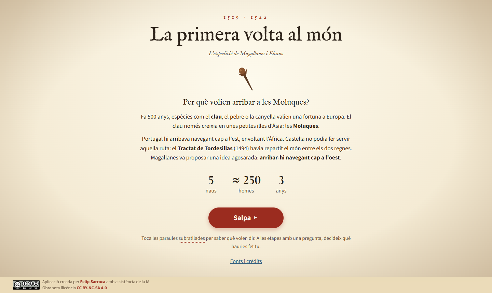
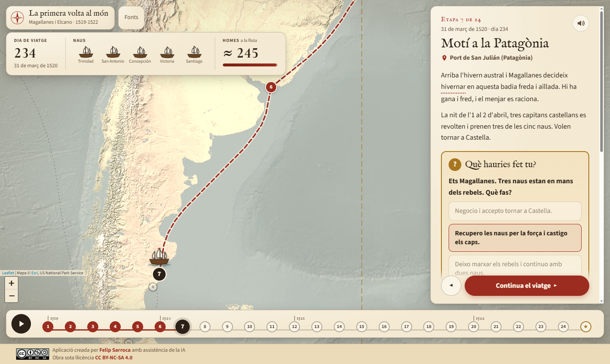
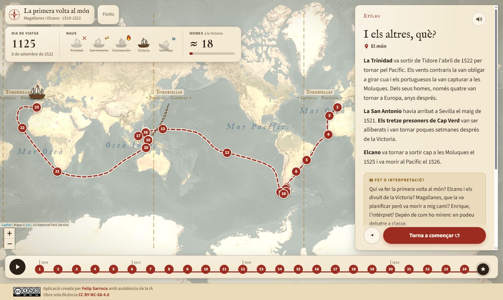
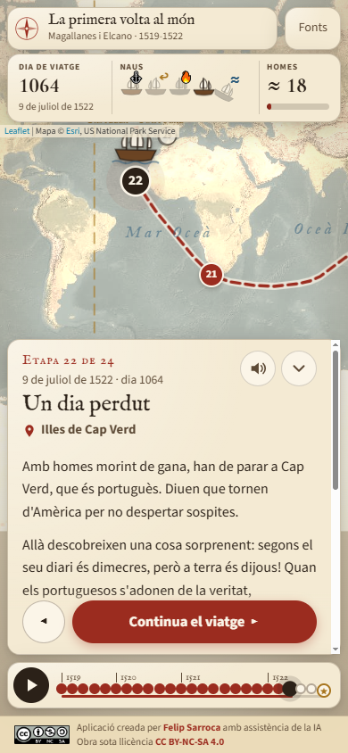

<div align="center">

# ⛵ La primera volta al món

Mapa animat en català per reviure l'expedició de Magallanes i Elcano (1519-1522), etapa per etapa


**[▶ Obre l'aplicació: ja.cat/magallanes](https://ja.cat/magallanes)**



</div>

---

## Què és

Una carta nàutica antiga on un vaixell recorre la ruta de la primera volta al món. L'alumnat avança amb un sol botó i, a cada etapa, veu com s'ho fan les naus i quanta gent queda a bord:

- 📅 **Dies de viatge**: el comptador avança mentre el vaixell navega.
- ⛵ **Naus**: les cinc naus es perden una a una (naufragi, deserció, incendi i captura).
- 👥 **Homes**: la barra baixa d'uns 250 homes als 18 que tornen.

Funciona en ordinador, tauleta, mòbil i pissarra digital.



## La idea pedagògica

| Element | Per a què serveix |
|---|---|
| **Viatge animat** | Fa visible la magnitud del viatge, sobretot els tres mesos al Pacífic. |
| **«Què hauries fet tu?»** | Quatre moments de decisió: el motí, la deserció, Mactan i la separació de les naus. L'alumne tria i després descobreix què va passar. La reproducció automàtica s'hi atura per debatre a classe. |
| **Fonts primàries** | Cites breus de Pigafetta i d'Elcano, en traducció adaptada. |
| **Fet o interpretació?** | Caixes que separen el que se sap del que són hipòtesis (els «gegants» patagons, Enrique de Malaca…). |
| **Una altra mirada** | El punt de vista dels pobles que trobaven: tupinambà, chamorros, Lapu-Lapu… |
| **Glossari** | Les paraules subratllades (escorbut, estret, Tordesillas…) es poden consultar amb un toc. |
| **Lectura en veu alta** | Botó 🔊 a cada etapa. |
| **Línia de Tordesillas** | Dibuixada al mapa amb el seu antimeridià, per entendre per què les Moluques eren en disputa. |

Encaixa amb el currículum de Ciències Socials de l'ESO (Decret 175/2022): pensament històric, ús de fonts, multiperspectiva i conflicte en l'expansió europea dels segles XV i XVI.



## Com fer-la servir a l'aula

- **Amb tot el grup (pissarra digital).** Premeu ▶ per reproduir el viatge sol. A cada decisió s'atura: voteu, debateu i continueu.
- **Individualment o per parelles.** Cada alumne avança al seu ritme amb «Continua el viatge». Les fletxes ← → del teclat també funcionen.
- **Enllaç a una etapa concreta.** Cada etapa té el seu enllaç (per exemple, `ja.cat/magallanes#mactan`). Va bé per a Google Classroom.
- **Per acabar.** L'epíleg explica què va passar amb les altres naus i planteja el debat: qui va fer realment la primera volta al món?

<p align="center"></p>

## Estructura del codi

Web estàtica, sense compilació ni dependències instal·lades. Fa servir [Leaflet](https://leafletjs.com) per al mapa.

```
VoltaMon/
├── index.html
├── css/styles.css
├── js/
│   ├── main.js           Estat, navegació, reproducció automàtica i teclat
│   ├── mapa.js           Mapa, ruta contínua sobre el Pacífic i animació del vaixell
│   ├── marcador.js       Comptadors de dies, naus i homes
│   ├── targeta.js        Text de l'etapa, decisions, glossari i lectura en veu alta
│   ├── cronologia.js     Barra d'etapes inferior
│   ├── util.js           Dates, geometria i utilitats
│   └── dades/
│       ├── etapes.js     ← Tot el contingut històric: 24 etapes i l'epíleg
│       ├── glossari.js
│       └── fonts.js
└── assets/
```

**Per corregir o ampliar el contingut només cal editar `js/dades/etapes.js`.** Els dies de viatge es calculen a partir de les dates. Les longituds es «despleguen» automàticament perquè la ruta travessi el Pacífic sense talls.

Per provar-la en local cal un servidor (els mòduls JS no funcionen amb `file://`):

```bash
python -m http.server
```

## Rigor històric

- Les xifres de tripulants són aproximades: les fonts parlen de 234 a 265 homes a la sortida.
- Les dates segueixen el calendari julià. Les dates i rutes aproximades es marquen amb ≈.
- Fonts principals: el diari d'Antonio Pigafetta, la carta d'Elcano a Carles I (1522), el quadern de bitàcola de Francisco Albo i el testimoni de Ginés de Mafra. La llista completa és a l'app, al botó **Fonts**.

## Autoria i llicència

Aplicació creada per [Felip Sarroca](https://ja.cat/felipsarroca) amb assistència de la IA. Obra sota llicència [CC BY-NC-SA 4.0](https://creativecommons.org/licenses/by-nc-sa/4.0/deed.ca).

Mapa base: © Esri, US National Park Service.
