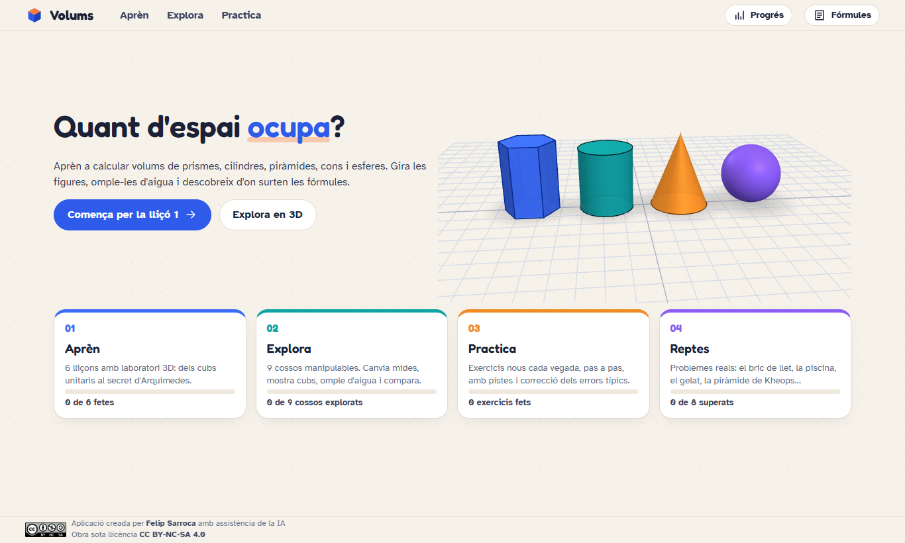
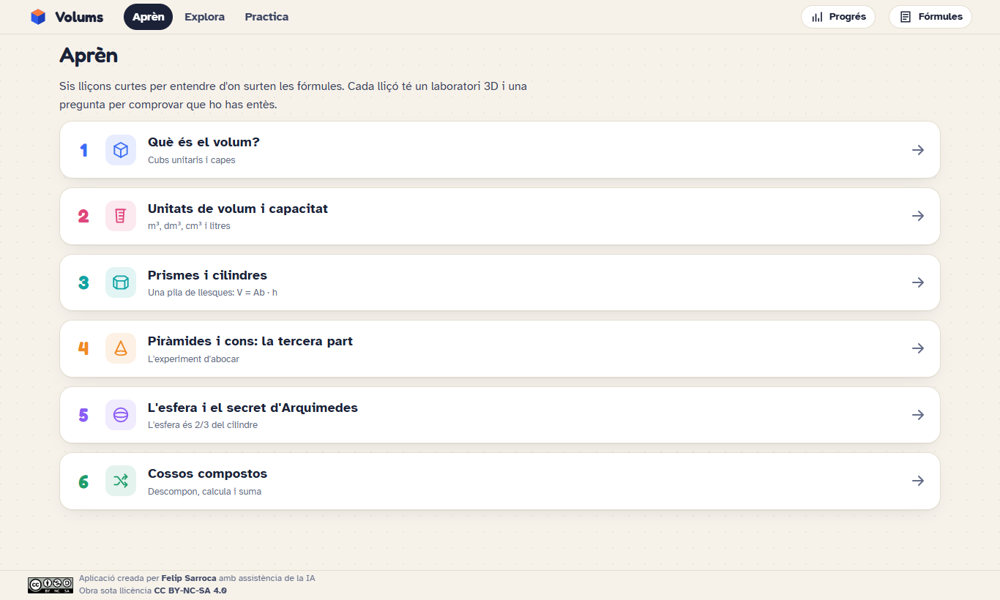
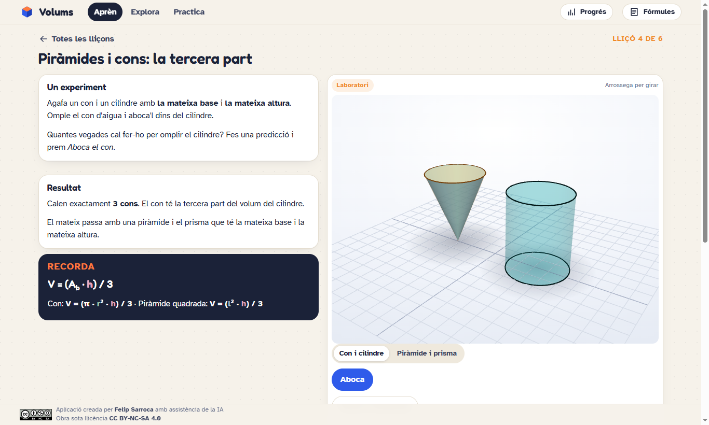
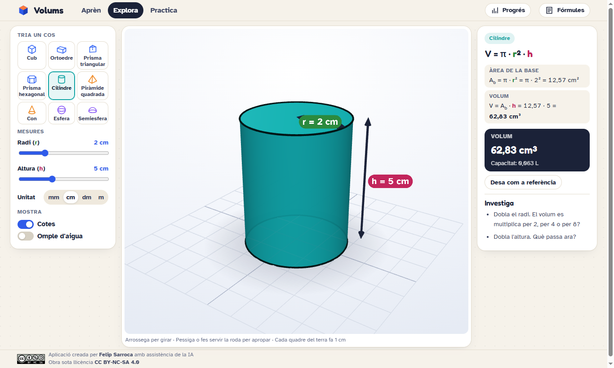
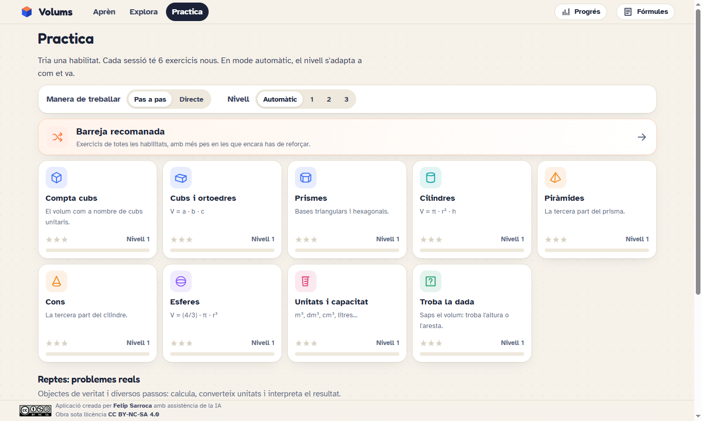
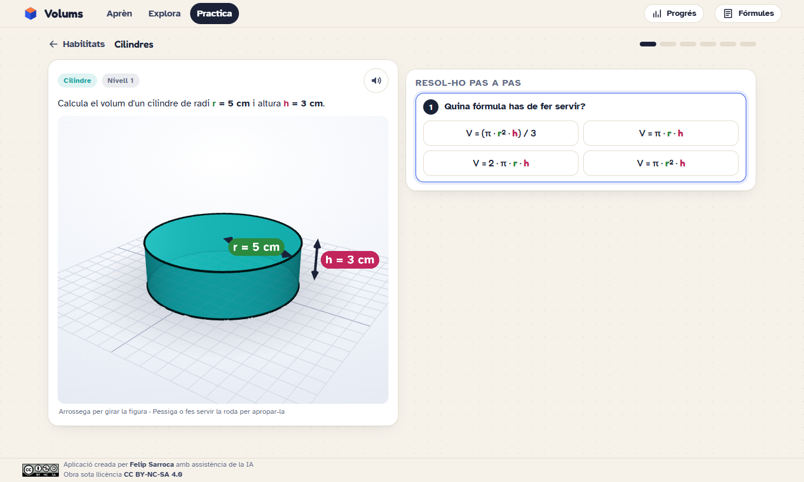
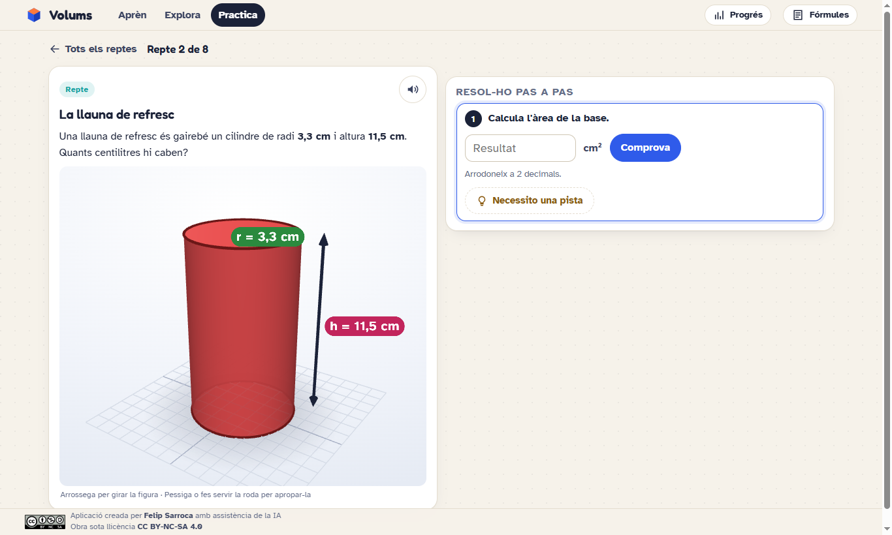
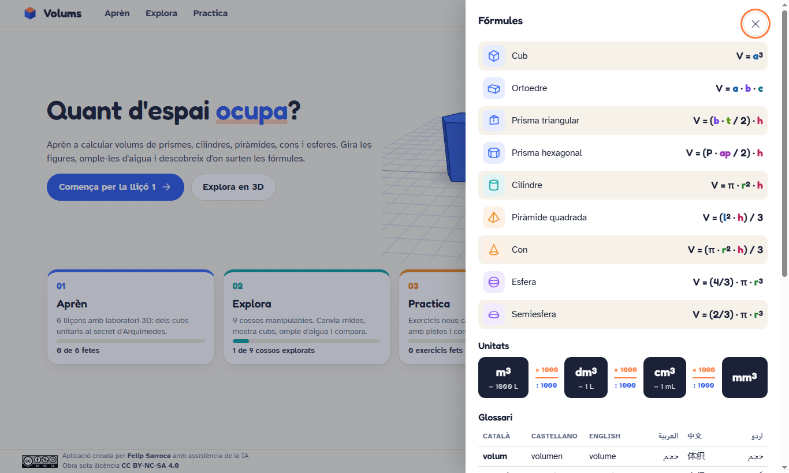

<div align="center">

# 🧊 Volums

Aplicació web interactiva en català per aprendre, explorar i practicar el càlcul de volums a l'ESO amb figures 3D


**[▶ Obre l'aplicació: ja.cat/calculvolums](https://ja.cat/calculvolums)**



</div>

---

## Índex

1. [Què és](#què-és)
2. [La idea pedagògica](#la-idea-pedagògica)
3. [Aprèn: sis lliçons](#aprèn-sis-lliçons)
4. [Explora: el laboratori 3D](#explora-el-laboratori-3d)
5. [Practica: nou habilitats](#practica-nou-habilitats)
6. [Reptes: problemes reals](#reptes-problemes-reals)
7. [Fórmules, unitats i glossari](#fórmules-unitats-i-glossari)
8. [Com fer-la servir a l'aula](#com-fer-la-servir-a-laula)
9. [Accés i execució](#accés-i-execució)
10. [Estructura del codi](#estructura-del-codi)
11. [Privacitat](#privacitat)
12. [Referències curriculars](#referències-curriculars)
13. [Autoria i llicència](#autoria-i-llicència)

---

## Què és

**Volums** ensenya a calcular el volum de prismes, cilindres, piràmides, cons, esferes i cossos compostos. L'alumnat **gira les figures**, les **omple d'aigua**, compta cubs unitaris i descobreix d'on surten les fórmules abans de fer-les servir.

- 🖥️ Funciona en ordinador, tauleta, mòbil i pissarra digital.
- 🧱 Té cinc espais: **Aprèn**, **Explora**, **Practica**, **Reptes** i **Progrés**, i una xuleta de **Fórmules** sempre a mà.
- 🩺 Cada resposta incorrecta es compara amb els errors típics i rep un missatge específic.
- 🗣️ Lectura en veu alta dels enunciats i glossari en sis llengües, pensat per a l'alumnat nouvingut.

## La idea pedagògica

| Principi | Com es concreta a l'app |
|---|---|
| **Concret → pictòric → abstracte** | Primer es compten cubs unitaris, després es veuen capes i llesques i finalment s'arriba a la fórmula. |
| **Comprendre abans de memoritzar** | Cada fórmula es deriva: V = Ab · h (pila de llesques), ÷ 3 (experiment d'abocar el con), 4/3 (Arquimedes). |
| **Bastida retirable** | Mode *pas a pas* (fórmula → base → volum → unitat) o mode *directe*, amb pistes progressives. |
| **L'error com a informació** | Diagnosi d'errors típics: unitats quadrades, oblidar dividir per 3, diàmetre en lloc de radi, confondre àrea i volum, factor de conversió erroni… |
| **Progressió adaptativa** | Tres nivells per habilitat; en mode automàtic, el nivell puja o baixa segons el domini recent. |
| **Context real** | Reptes amb objectes de veritat: el bric de llet, la llauna, la piscina, el gelat, la piràmide de Kheops. |
| **Accessibilitat (DUA)** | Veu alta, glossari multilingüe, coma decimal, tipografia molt llegible i botons grans per a pantalla tàctil. |

## Aprèn: sis lliçons

Lliçons curtes amb un **laboratori 3D** i una pregunta de comprovació al final.

1. **Què és el volum?** Cubs unitaris, comptatge per capes i V = a · b · c.
2. **Unitats de volum i capacitat.** 1 dm³ = 1000 cm³ = 1 L i l'escala ×1000.
3. **Prismes i cilindres.** Una pila de llesques: V = Ab · h, i el principi de Cavalieri.
4. **Piràmides i cons: la tercera part.** L'experiment d'abocar: V = (Ab · h) / 3.
5. **L'esfera i el secret d'Arquimedes.** L'esfera és 2/3 del cilindre circumscrit: V = (4/3) · π · r³.
6. **Cossos compostos.** Descompon, calcula i suma (o resta).



A la lliçó 4, l'alumne fa una predicció i prem **Aboca**: el con s'aboca dins del cilindre fins a omplir-lo amb tres cons. El mateix experiment es pot fer amb una piràmide i el seu prisma.



## Explora: el laboratori 3D

Nou cossos manipulables: cub, ortoedre, prisma triangular, prisma hexagonal, cilindre, piràmide quadrada, con, esfera i semiesfera.

- 🎚️ **Lliscadors** per canviar les mides i selector d'unitat (mm, cm, dm, m).
- 📏 **Cotes** de colors sobre la figura, amb el mateix color que la variable a la fórmula.
- 💧 **Omple d'aigua** i **mostra els cubs unitaris** per capes.
- 🧮 **Càlcul en directe**: àrea de la base, volum i capacitat en litres.
- 🔁 **Desa com a referència** per comparar dos cossos, i preguntes d'*Investiga* (què passa si dobles el radi?).



## Practica: nou habilitats

Compta cubs · Cubs i ortoedres · Prismes · Cilindres · Piràmides · Cons · Esferes · Unitats i capacitat · Troba la dada (problemes inversos).

Cada sessió té **6 exercicis generats aleatòriament**. L'alumne tria la manera de treballar (*pas a pas* o *directe*) i el nivell (*automàtic*, 1, 2 o 3). La **barreja recomanada** dona més pes a les habilitats que encara cal reforçar.

| Nivell | Què hi trobes |
|---|---|
| **1** | Nombres enters i unitat cm. |
| **2** | Decimals, diàmetre en lloc de radi i altres unitats. |
| **3** | Decimals més fins, conversions encadenades i problemes inversos amb context. |



En el mode *pas a pas*, l'alumne primer tria la fórmula, després calcula l'àrea de la base, el volum i finalment la unitat.



## Reptes: problemes reals

Vuit problemes de diversos passos: calcular, convertir unitats i interpretar el resultat.

| Repte | La pregunta |
|---|---|
| El bric de llet | Hi cap realment 1 litre? |
| La llauna de refresc | Per què diu 33 cl? |
| Omplir la piscina | Quantes hores per omplir-la? |
| El gelat | Con + semiesfera |
| La pilota de bàsquet | Quant d'aire hi ha a dins? |
| La tenda de campanya | Un prisma triangular estirat |
| El dipòsit d'aigua | Cilindre + semiesfera |
| La piràmide de Kheops | Un volum faraònic |



## Fórmules, unitats i glossari

El botó **Fórmules** obre una xuleta amb:

- les fórmules dels nou cossos, amb les variables acolorides;
- l'**escala d'unitats** m³ → dm³ → cm³ → mm³ (×1000 / :1000) i l'equivalència amb litres;
- un **glossari** en català, castellà, anglès, àrab, xinès i urdú.

La pantalla **Progrés** mostra el domini de cada habilitat, els punts i les insígnies.



## Com fer-la servir a l'aula

| Moment | Proposta |
|---|---|
| **Introducció** (pissarra digital) | Lliçons 1 i 2 en gran grup: fer prediccions abans de mostrar el resultat. |
| **Descoberta** (parelles) | Lliçons 3–5 i *Explora*: què passa amb el volum si dobles el radi? I l'altura? |
| **Pràctica** (individual) | Sessions de 6 exercicis en mode *pas a pas*; passar a *directe* quan l'alumne té tres estrelles. |
| **Aplicació** | Reptes amb objectes reals; es poden portar a classe el bric, la llauna o la pilota per mesurar-los. |
| **Autoavaluació** | Revisar la pantalla *Progrés* i triar la *barreja recomanada* per reforçar. |

Per a l'alumnat nouvingut o amb NESE: lectura en veu alta, glossari multilingüe i nivell 1 amb nombres enters.

## Accés i execució

- **En línia**: [ja.cat/calculvolums](https://ja.cat/calculvolums)
- **En local**: obre `index.html` en un navegador modern. No cal instal·lar res ni compilar.
- Cal connexió a internet per carregar Three.js i les tipografies.

## Estructura del codi

```
Volums/
├── index.html          Estructura, capçalera i peu
├── favicon.svg         Icona de l'app
├── PLA.md              Pla pedagògic i de disseny
├── css/styles.css      Estils i disseny adaptable
├── js/
│   ├── util.js         Utilitats, format numèric, veu alta i progrés
│   ├── shapes.js       Definició dels cossos i les seves fórmules
│   ├── viewer.js       Visor 3D (Three.js r147 + OrbitControls)
│   ├── exercises.js    Habilitats, generadors d'exercicis i reptes
│   ├── practice.js     Sessions de pràctica i diagnosi d'errors
│   ├── lessons.js      Les sis lliçons
│   ├── explore.js      Laboratori Explora
│   └── app.js          Inici, progrés, xuleta i enrutador
├── assets/             Imatge de la llicència
└── docs/captures/      Captures d'aquest README
```

## Privacitat

El progrés es desa només al `localStorage` del navegador. L'app no recull dades personals ni envia cap informació a servidors.

## Referències curriculars

Matemàtiques, Decret 175/2022 d'ordenació dels ensenyaments de l'educació bàsica (LOMLOE):

- **Sentit de la mesura**: magnituds, unitats del SI, estimació, volums de cossos geomètrics i relació volum-capacitat.
- **Sentit espacial**: reconeixement, visualització i manipulació de cossos geomètrics amb eines digitals.
- **Sentit socioafectiu**: perseverança, gestió de l'error i autoavaluació.
- **Competències específiques**: CE1–CE2 (resoldre problemes), CE3–CE4 (raonar i justificar), CE6 (connectar amb la realitat) i CE8 (comunicar amb llenguatge matemàtic).

## Autoria i llicència

Aplicació creada per [Felip Sarroca](https://ja.cat/felipsarroca) amb assistència de la IA.

Obra sota llicència [Creative Commons BY-NC-SA 4.0](https://creativecommons.org/licenses/by-nc-sa/4.0/deed.ca).
